# Guía del estudiante

Cómo usar tu enlace personal desde el celular: revisar y aceptar tu propuesta, pagar con QR, enviar tus datos y archivos, y seguir el avance de tu tesis.

## 1. Abrir tu enlace y entrar {#entrar}

**Para qué sirve:** entrar a tu portal privado, donde está todo sobre tu tesis.

1. Abre el enlace que te enviaron por WhatsApp. Se abre en tu navegador.
2. Escribe tu **carnet de identidad (CI)** (1), o el **PIN** de 6 números si te dieron uno.
3. Toca **Entrar** (2).

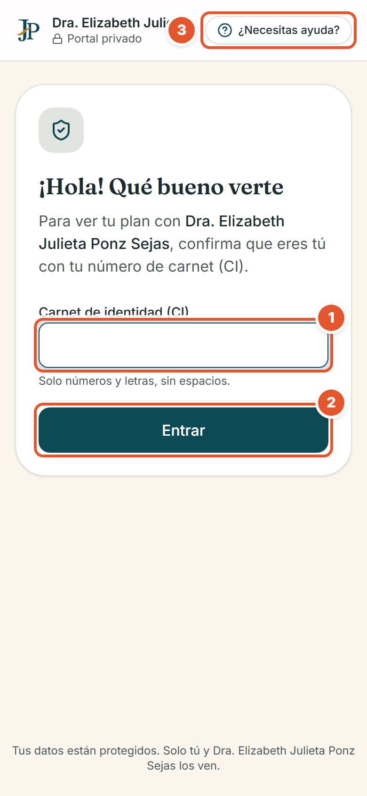

Si te equivocas, verás cuántos intentos te quedan.

> **Importante:** después de 5 intentos fallidos el acceso se bloquea 15 minutos. Espera y vuelve a intentarlo.

> **Consejo:** guarda el enlace en tus favoritos o en un chat contigo mismo. Lo vas a usar todo el semestre.

Arriba siempre tienes el botón **¿Necesitas ayuda?** (3), que abre esta guía.

## 2. Revisar y aceptar la propuesta {#aceptar}

**Para qué sirve:** ver el plan de pagos y el cronograma antes de comenzar.

1. Arriba ves tus **pasos** (1): Aceptar, Pagar, Formulario, Archivos y Avance. El número resaltado es el que te toca.
2. Revisa la **inversión total** y el nivel (2).

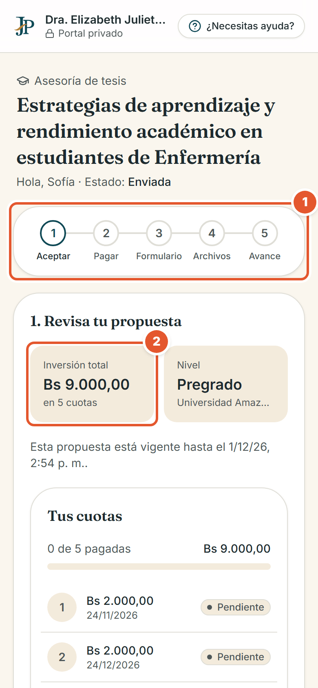

3. Baja para ver **tus cuotas** (1), con montos y fechas, y el **cronograma** (2): qué se hace cada mes.

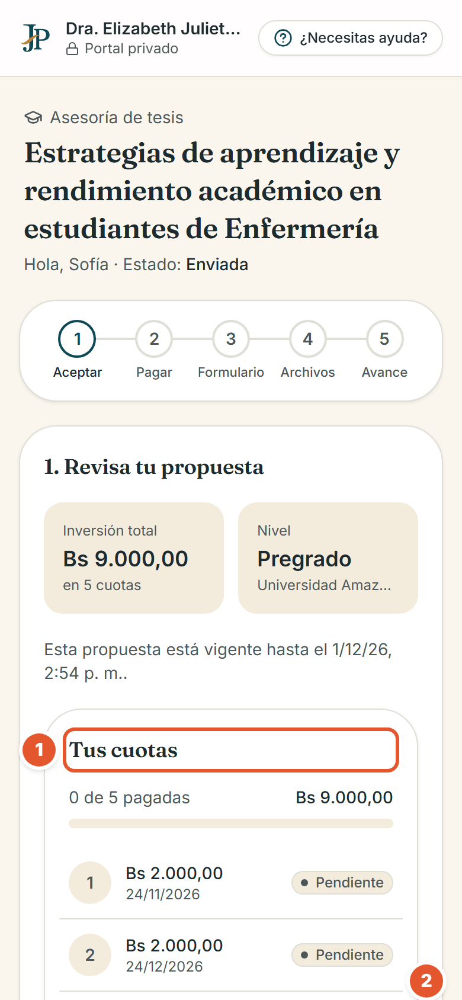

4. Si quieres, toca **Descargar PDF** (1) para guardar la propuesta.
5. Toca **Acepto la propuesta** (2).

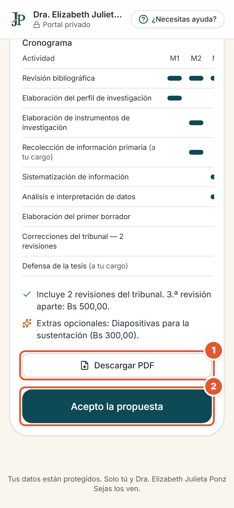

6. Confirma con **Sí, acepto**.

> **Importante:** la propuesta tiene una **fecha límite** (la ves en pantalla). Si pasa, el enlace deja de funcionar: pídele uno nuevo a la Dra.

## 3. Pagar con QR y subir el comprobante {#pagar}

**Para qué sirve:** pagar tu cuota desde la app de tu banco y avisar que ya pagaste.

1. Mira el **monto exacto a pagar** (1). Está siempre en bolivianos.
2. Abre la app de tu banco, elige pagar con QR y escanea el **código QR** (2). Si no puedes escanear, usa los datos bancarios que están debajo.

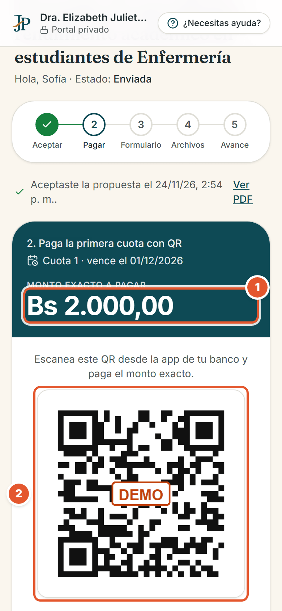

3. Paga **el monto exacto** y guarda el comprobante (captura de pantalla o PDF).
4. Vuelve al portal y toca **Ya pagué, subir comprobante** (1).

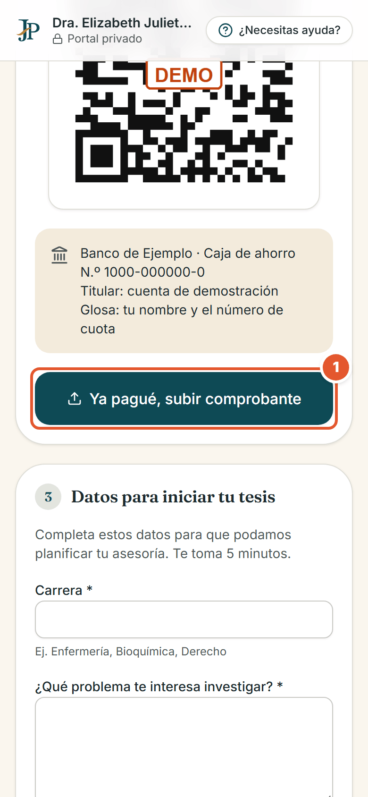

5. Toca el recuadro, elige la foto o el PDF del comprobante (1) y toca **Enviar comprobante** (2).

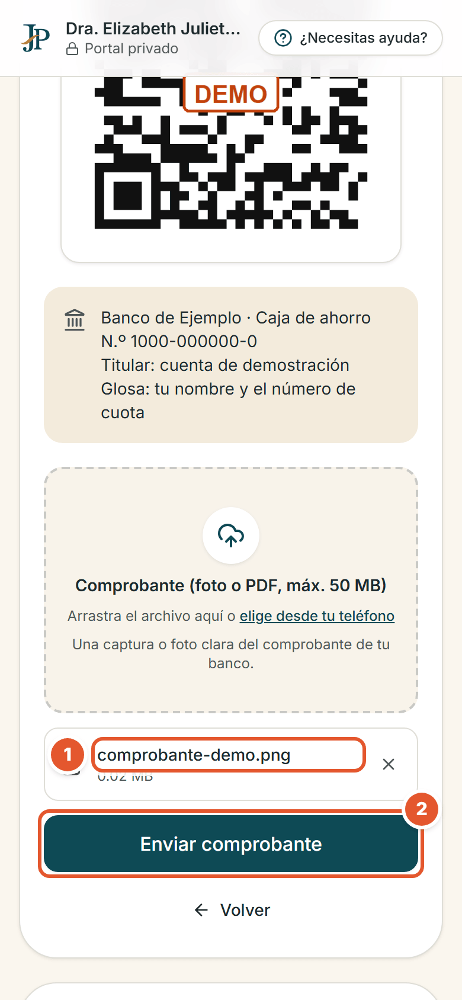

6. Verás el mensaje **¡Comprobante enviado!** (1).

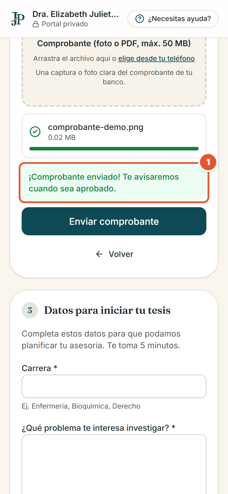

7. En **Tus cuotas**, esa cuota queda **En revisión** hasta que la Dra. la apruebe.

> **Importante:** después de enviar, el recuadro de pago ya muestra tu **siguiente cuota**. No la pagues ahora: págala en su fecha.

> **Consejo:** si tu plan está en reales (R$), el portal te muestra cuánto es en bolivianos el día que pagas, con el tipo de cambio oficial.

Si la Dra. rechaza un comprobante, verás el **motivo** en tu historial de pagos y podrás subir otro.

## 4. Llenar el formulario {#formulario}

**Para qué sirve:** darle a la Dra. los datos que necesita para planificar tu tesis.

1. Completa cada campo. Los que tienen un asterisco («*») son obligatorios (1, 2).

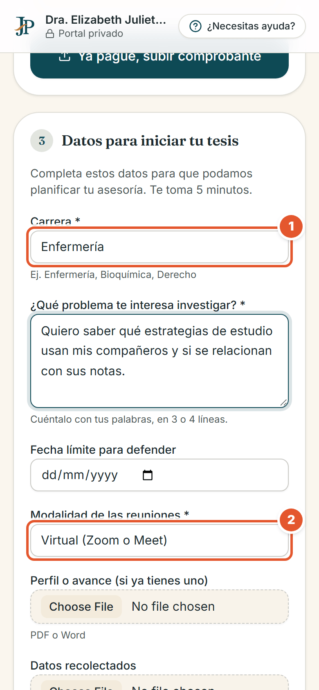

2. Si te pide archivos, toca el campo y elige el archivo (3).
3. Toca **Enviar formulario** (4).

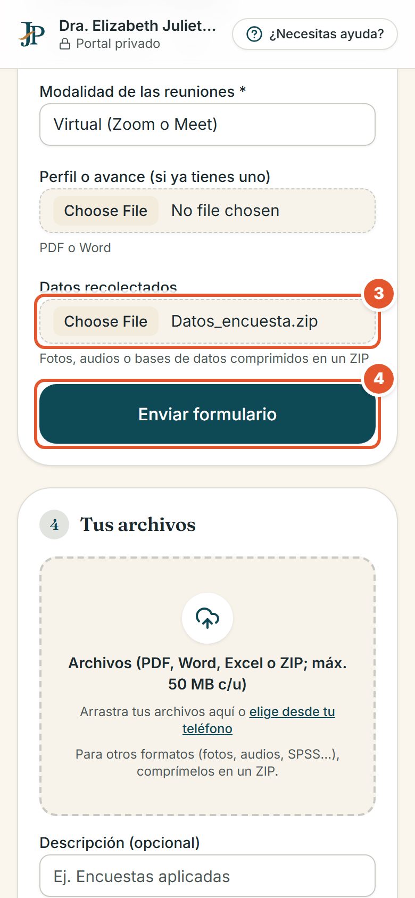

4. Verás **Formulario enviado**. Si te equivocaste, puedes volver a enviarlo: se reemplaza.

## 5. Subir archivos o un ZIP {#archivos}

**Para qué sirve:** enviarle a la Dra. tus avances, encuestas o datos cuando quieras.

1. En **Tus archivos**, toca el recuadro (1) y elige uno o varios archivos: **PDF, Word, Excel o ZIP**.
2. Si quieres, escribe una **descripción** (2), por ejemplo «Avance del capítulo 1».
3. Toca **Subir archivos** (3).

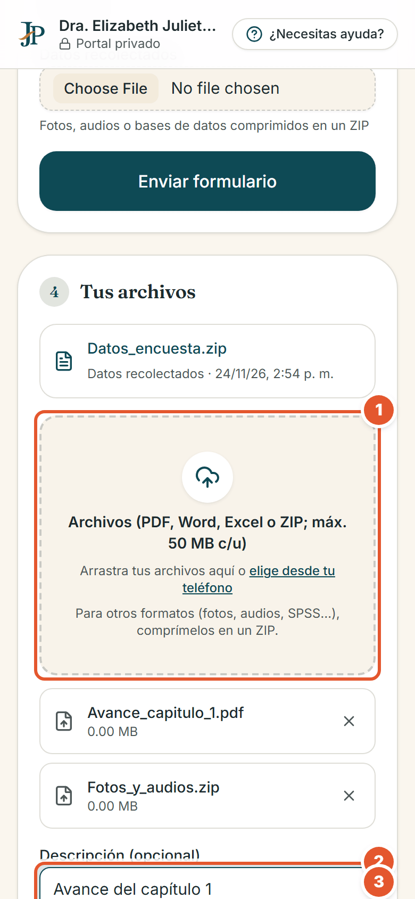

4. Cuando terminan de subir, verás **Archivos subidos**.

> **Importante:** cada archivo puede pesar **hasta 50 MB**. Para fotos, audios u otros formatos, ponlos todos en un **ZIP** (en el celular: mantén presionados los archivos → Comprimir).

## 6. Ver tu avance y la próxima cuota {#avance}

**Para qué sirve:** saber cómo va tu tesis y cuándo pagas la siguiente cuota.

1. El **porcentaje completado** (1) sube a medida que la Dra. marca las actividades terminadas.
2. **Este mes** (2) te dice qué toca hacer ahora.
3. **Próxima cuota** (3) te dice cuánto y cuándo pagas.

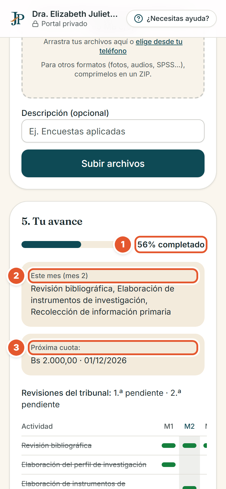

En tu portal también está el **historial de pagos**, con cada pago aprobado o rechazado.

## 7. Pedir la 3.ª revisión o un extra {#extras}

**Para qué sirve:** pedir servicios que se cobran aparte, como la 3.ª revisión del tribunal o las diapositivas para tu defensa.

1. Baja hasta **¿Necesitas algo más?**
2. Toca **Pedir 3.ª revisión** (1) o **Pedir diapositivas** (2).

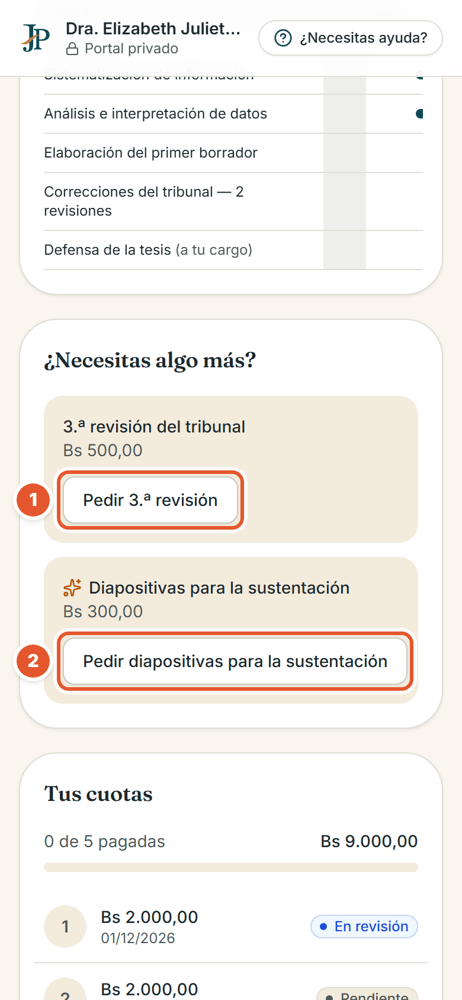

3. Confirma. Cuando la Dra. lo apruebe, se agrega **una cuota nueva** a tu plan.

## 8. Si tu proyecto queda en pausa {#pausa}

**Para qué sirve:** saber qué hacer si te atrasaste con un pago.

Si una cuota pasa los días de gracia, verás **Tu proyecto está en pausa** (1) y el monto a pagar, que puede incluir un recargo (2).

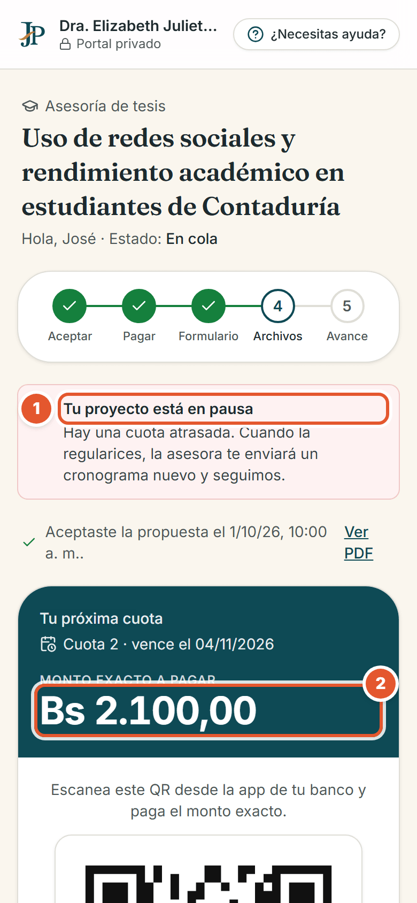

1. Paga la cuota atrasada y sube el comprobante, como siempre.
2. La Dra. te enviará un **cronograma nuevo** con las fechas corridas.
3. Revísalo y toca **Acepto el nuevo cronograma** (1). Tu proyecto vuelve a avanzar.

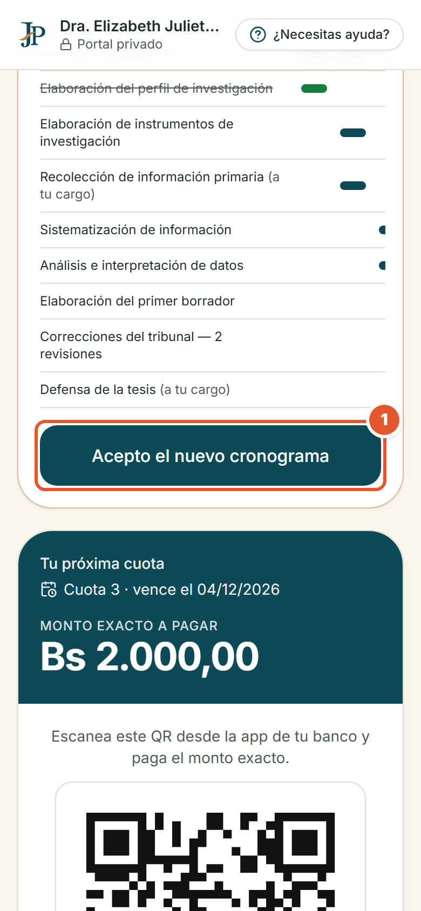

## 9. Si algo falla {#si-algo-falla}

**Para qué sirve:** resolver los problemas más comunes sin esperar.

- **«Enlace no disponible»** (1): el enlace venció o te enviaron uno nuevo. Busca el último enlace en tu WhatsApp o pídele uno nuevo a la Dra.

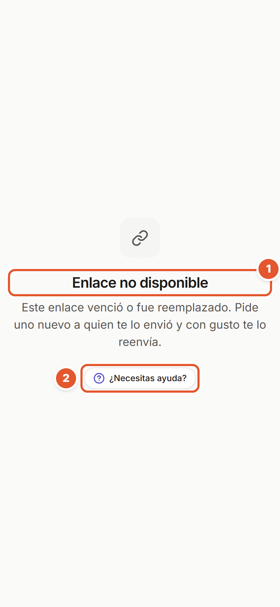

- **«Dato incorrecto»**: revisa tu CI. Si la Dra. lo registró con extensión (por ejemplo «LP»), escríbela también.
- **Bloqueado**: te equivocaste 5 veces. Espera 15 minutos.
- **Perdí el PIN**: pídele a la Dra. un enlace nuevo.
- **No sube el archivo**: revisa que pese menos de 50 MB y que sea PDF, Word, Excel, ZIP (o foto o PDF para el comprobante). Prueba con wifi.
- **Pagué otro monto**: avísale a la Dra. por WhatsApp antes de subir el comprobante.
- **Se cerró la sesión**: por seguridad dura 2 horas. Vuelve a abrir el enlace y escribe tu CI.

> **Consejo:** si nada de esto funciona, escríbele a la Dra. por WhatsApp con una captura de pantalla de lo que ves.

Tus datos están protegidos: solo tú y la Dra. los ven.
