# Guia do estudante

Como usar o seu link pessoal no celular: revisar e aceitar a proposta, pagar com QR, enviar seus dados e arquivos e acompanhar o andamento da sua tese.

> **Nota:** as telas do portal estão em **espanhol**. Nesta guia, cada botão aparece com o nome em espanhol, como você o verá, e a tradução entre parênteses.

## 1. Abrir o link e entrar {#entrar}

**Para que serve:** entrar no seu portal privado, onde está tudo sobre a sua tese.

1. Abra o link que você recebeu pelo WhatsApp. Ele abre no navegador.
2. Digite o seu **documento de identidade (CI)** (1) ou o **PIN** de 6 números, se recebeu um.
3. Toque em **Entrar** (2).

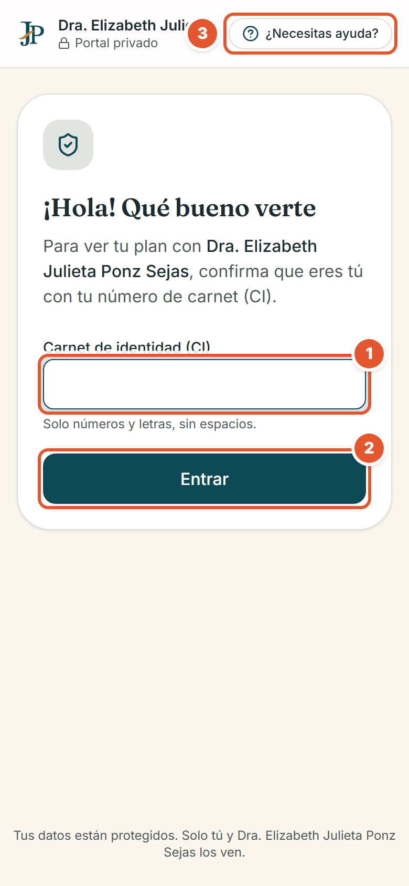

Se errar, a tela mostra quantas tentativas restam («Dato incorrecto» = dado incorreto).

> **Importante:** depois de 5 tentativas erradas, o acesso fica bloqueado por 15 minutos. Espere e tente de novo.

> **Dica:** salve o link nos favoritos ou numa conversa com você mesmo. Você vai usá-lo o semestre todo.

No topo sempre aparece o botão **¿Necesitas ayuda?** (Precisa de ajuda?) (3), que abre esta guia. Lá você pode escolher **Português**.

## 2. Revisar e aceitar a proposta {#aceptar}

**Para que serve:** ver o plano de pagamento e o cronograma antes de começar.

1. No topo estão os seus **passos** (1): Aceptar (aceitar), Pagar, Formulario, Archivos (arquivos) e Avance (andamento). O número em destaque é o que falta.
2. Confira o **investimento total** («Inversión total») e o nível (2).

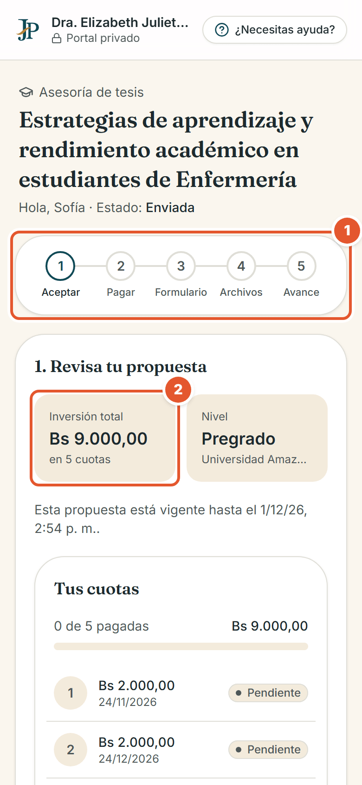

3. Role para ver **as suas parcelas** («Tus cuotas») (1), com valores e datas, e o **cronograma** (2): o que se faz em cada mês.

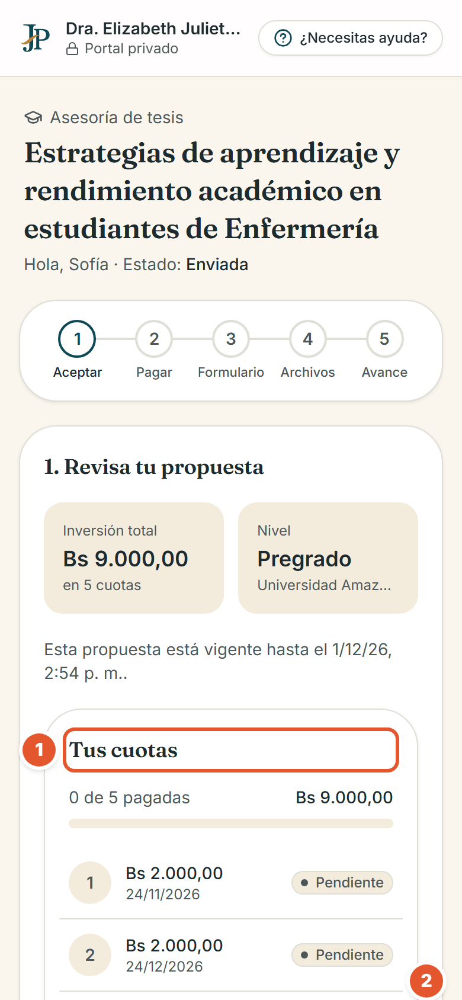

4. Se quiser, toque em **Descargar PDF** (baixar PDF) (1).
5. Toque em **Acepto la propuesta** (aceito a proposta) (2).

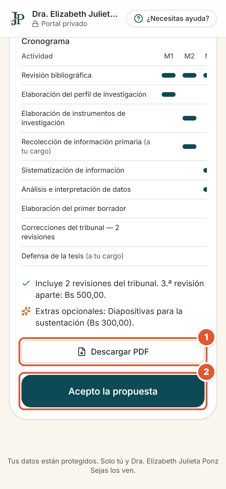

6. Confirme com **Sí, acepto** (sim, aceito).

> **Importante:** a proposta tem um **prazo** (aparece na tela). Depois dele, o link deixa de funcionar: peça um novo à Dra.

## 3. Pagar com QR e enviar o comprovante {#pagar}

**Para que serve:** pagar a parcela pelo app do seu banco e avisar que já pagou.

1. Veja o **valor exato a pagar** («Monto exacto a pagar») (1). Ele é sempre em **bolivianos (Bs)**.
2. Abra o app do seu banco, escolha pagar com QR e escaneie o **código QR** (2). Se não conseguir, use os dados bancários que aparecem abaixo.

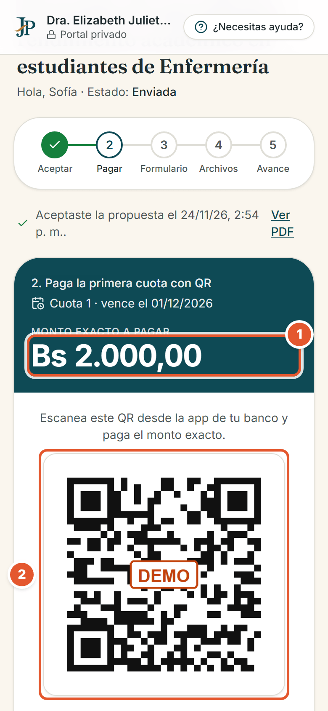

3. Pague **o valor exato** e guarde o comprovante (print ou PDF).
4. Volte ao portal e toque em **Ya pagué, subir comprobante** (já paguei, enviar comprovante) (1).

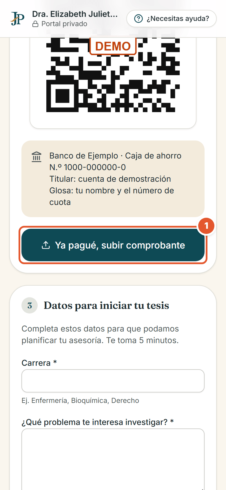

5. Toque no quadro, escolha a foto ou o PDF do comprovante (1) e toque em **Enviar comprobante** (enviar comprovante) (2).

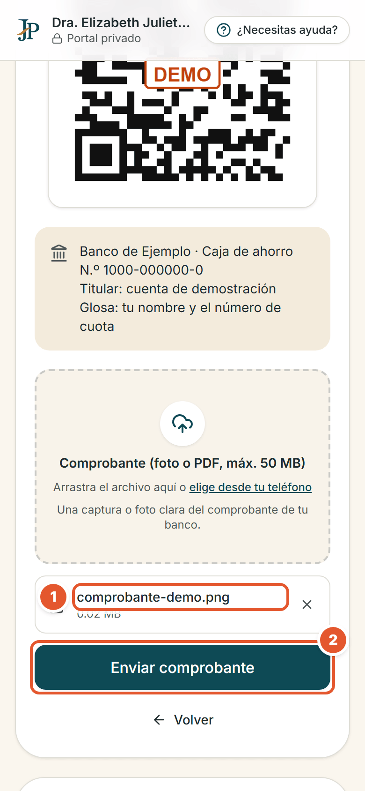

6. Aparece a mensagem **¡Comprobante enviado!** (comprovante enviado) (1).

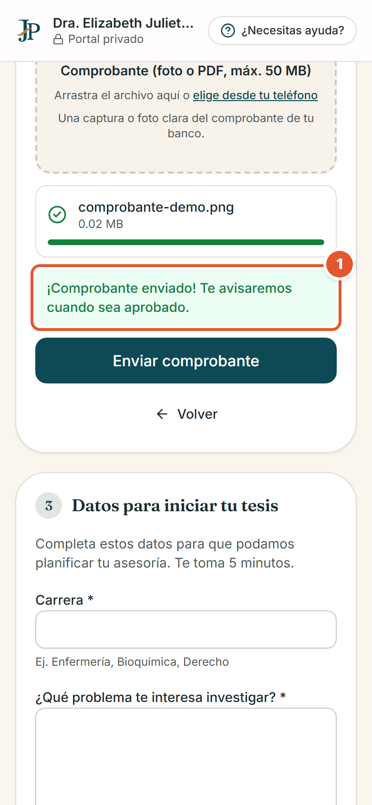

7. Em «Tus cuotas», a parcela fica **En revisión** (em análise) até a Dra. aprovar.

> **Importante:** depois de enviar, o quadro de pagamento já mostra a sua **próxima parcela**. Não pague agora: pague na data dela.

> **Dica:** se o seu plano é em **reais (R$)**, o portal mostra quanto dá em bolivianos no dia do pagamento, com a cotação oficial do Banco Central da Bolívia.

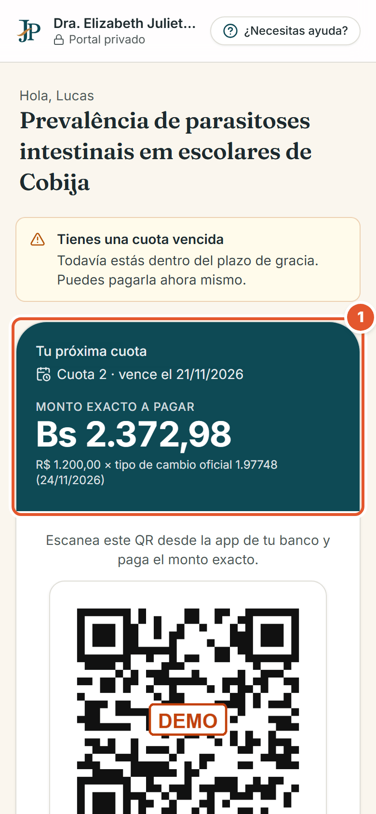

Se a Dra. recusar um comprovante, você verá o **motivo** («Motivo») no histórico de pagamentos e poderá enviar outro.

## 4. Preencher o formulário {#formulario}

**Para que serve:** passar para a Dra. os dados que ela precisa para planejar a sua tese.

1. Preencha cada campo. Os que têm asterisco («*») são obrigatórios (1, 2).

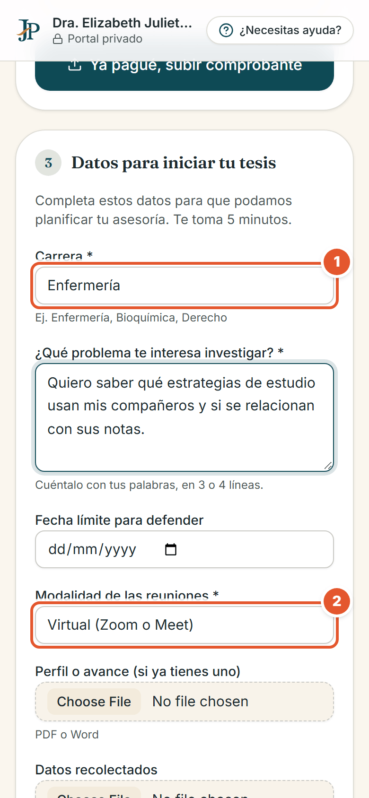

2. Se pedir arquivos, toque no campo e escolha o arquivo (3).
3. Toque em **Enviar formulario** (enviar formulário) (4).

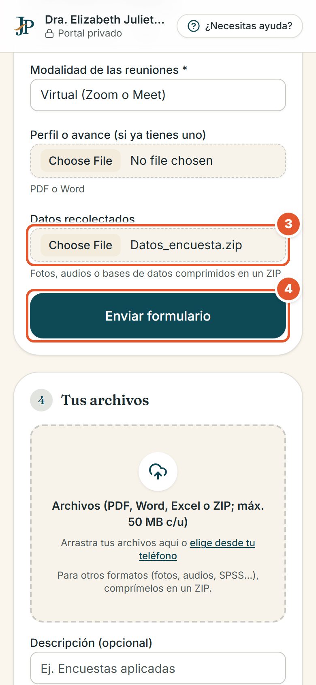

4. Aparece **Formulario enviado**. Se errou algo, pode enviar de novo: as respostas são substituídas.

## 5. Enviar arquivos ou um ZIP {#archivos}

**Para que serve:** mandar para a Dra. seus avanços, questionários ou dados quando quiser.

1. Em **Tus archivos** (seus arquivos), toque no quadro (1) e escolha um ou mais arquivos: **PDF, Word, Excel ou ZIP**.
2. Se quiser, escreva uma **descrição** («Descripción») (2), por exemplo «Avanço do capítulo 1».
3. Toque em **Subir archivos** (enviar arquivos) (3).

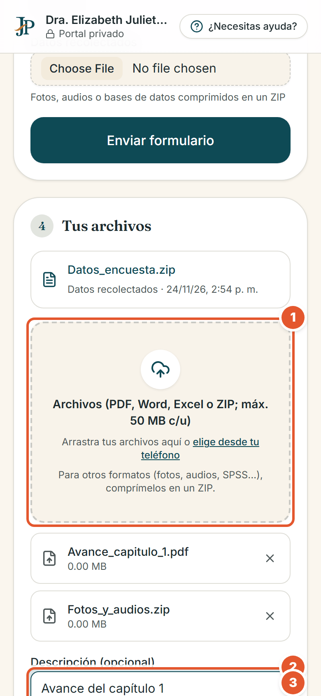

4. Ao terminar, aparece **Archivos subidos** (arquivos enviados).

> **Importante:** cada arquivo pode ter **até 50 MB**. Fotos, áudios ou outros formatos: coloque tudo num **ZIP** (no celular: segure os arquivos → Compactar).

## 6. Ver o andamento e a próxima parcela {#avance}

**Para que serve:** saber como vai a sua tese e quando paga a próxima parcela.

1. A **porcentagem concluída** («completado») (1) sobe conforme a Dra. marca as atividades terminadas.
2. **Este mes** (este mês) (2) diz o que fazer agora.
3. **Próxima cuota** (próxima parcela) (3) diz quanto e quando pagar.

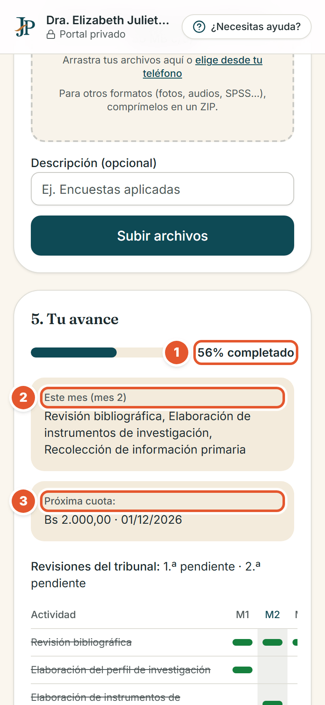

No portal também está o **histórico de pagamentos** («Historial de pagos»).

## 7. Pedir a 3.ª revisão ou um extra {#extras}

**Para que serve:** pedir serviços cobrados à parte, como a 3.ª revisão da banca ou os slides da defesa.

1. Role até **¿Necesitas algo más?** (precisa de algo mais?).
2. Toque em **Pedir 3.ª revisión** (1) ou **Pedir diapositivas…** (slides) (2).

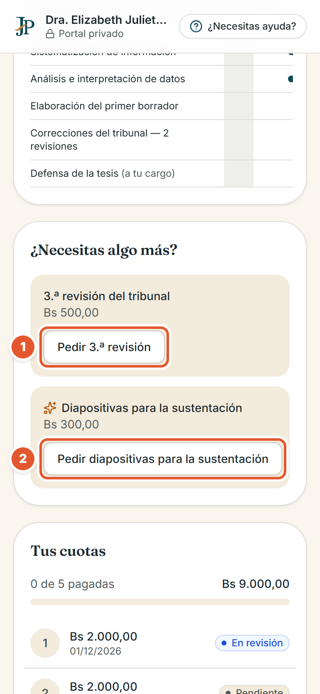

3. Confirme. Quando a Dra. aprovar, **uma nova parcela** é adicionada ao seu plano.

## 8. Se o projeto ficar em pausa {#pausa}

**Para que serve:** saber o que fazer se atrasou um pagamento.

Se uma parcela passar dos dias de tolerância, aparece **Tu proyecto está en pausa** (seu projeto está em pausa) (1) e o valor a pagar, que pode incluir uma multa (2).

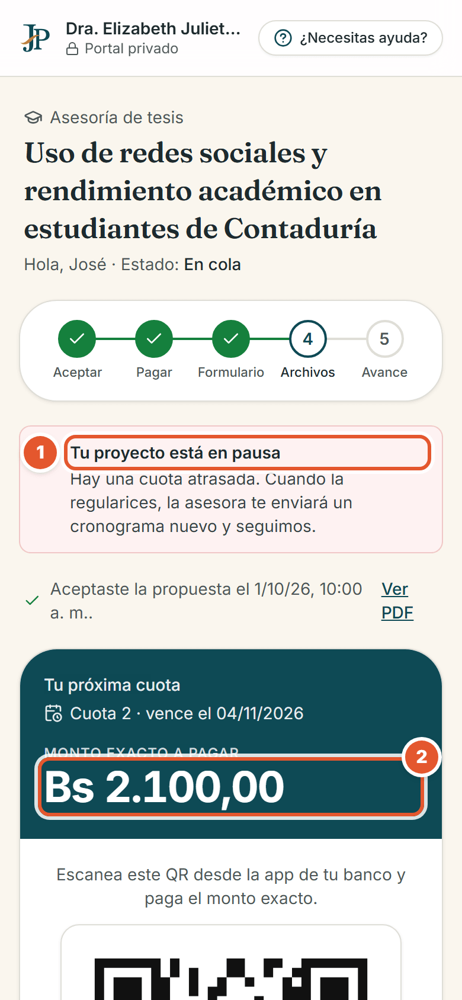

1. Pague a parcela atrasada e envie o comprovante, como sempre.
2. A Dra. vai enviar um **cronograma novo** com as datas ajustadas.
3. Confira e toque em **Acepto el nuevo cronograma** (aceito o novo cronograma) (1). O projeto volta a andar.

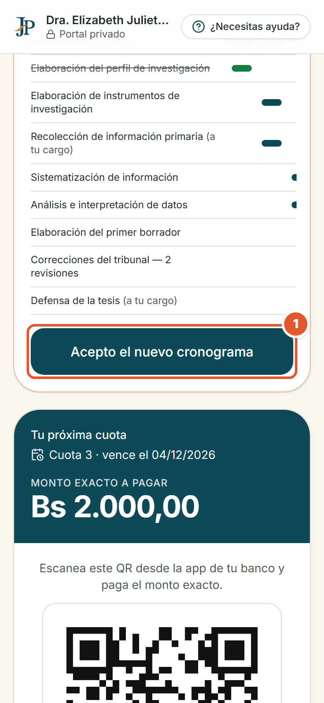

## 9. Se algo der errado {#si-algo-falla}

**Para que serve:** resolver os problemas mais comuns sem esperar.

- **«Enlace no disponible»** (link indisponível) (1): o link venceu ou você recebeu um novo. Procure o último link no WhatsApp ou peça um novo à Dra.

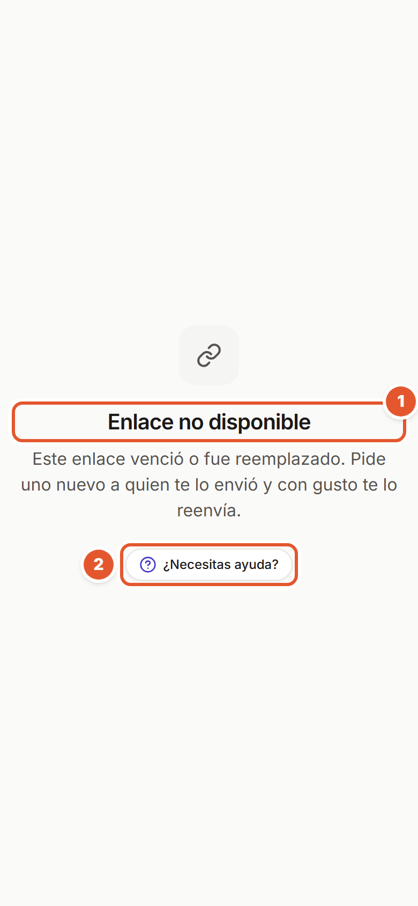

- **«Dato incorrecto»**: confira o seu documento. Ele deve ser igual ao que a Dra. cadastrou.
- **Bloqueado**: você errou 5 vezes. Espere 15 minutos.
- **Perdi o PIN**: peça um link novo à Dra.
- **O arquivo não sobe**: confira se tem menos de 50 MB e se é PDF, Word, Excel ou ZIP (ou foto ou PDF, no caso do comprovante). Tente no wi-fi.
- **Paguei outro valor**: avise a Dra. pelo WhatsApp antes de enviar o comprovante.
- **A sessão fechou**: por segurança ela dura 2 horas. Abra o link de novo e digite o seu documento.

> **Dica:** se nada disso resolver, mande para a Dra. pelo WhatsApp um print da tela que você está vendo.

Seus dados estão protegidos: só você e a Dra. podem vê-los.
