# Manual de uso del panel

Guía paso a paso para la Dra. Julieta Ponz: cómo cobrar en cuotas, enviar propuestas de asesoría de tesis y acompañar a cada estudiante desde el panel.

<!-- Las capturas se regeneran con `npm run manual:capturas` (datos ficticios). El PDF, con `npm run manual:pdf`. -->

## 1. Primeros pasos {#primeros-pasos}

**Para qué sirve:** entrar al panel, cuidar tu contraseña y ubicarte en la pantalla de inicio.

### Entrar al panel {#entrar}

1. Abre tu navegador (Chrome, Edge o Safari) y entra a **julietaponz.com/login**.
2. Escribe tu **correo** (1) y tu **contraseña** (2).
3. Haz clic en **Ingresar** (3).

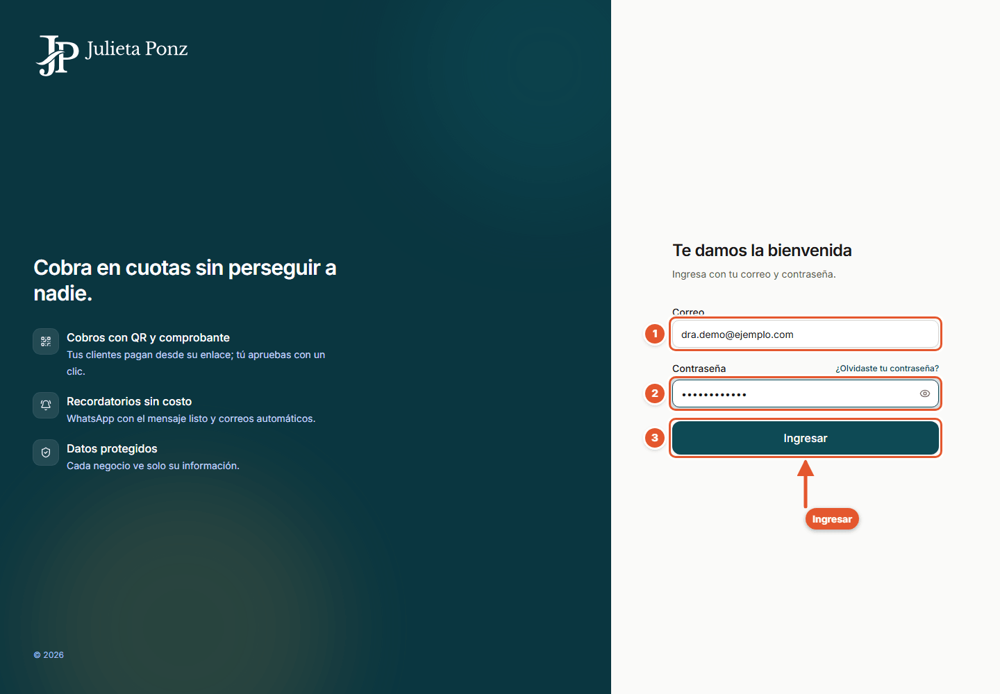

> **Consejo:** guarda la dirección en los favoritos del navegador. Así entras con un solo clic.

> **Importante:** si te equivocas 10 veces seguidas, el acceso se bloquea 15 minutos para proteger tu cuenta. Espera y vuelve a intentarlo.

### Cambiar o recuperar tu contraseña {#contrasena}

**Para cambiarla** (sabes la actual):

1. Arriba a la derecha, haz clic en **tu nombre** → **Mi cuenta y contraseña**.
2. Escribe tu **contraseña actual** (1).
3. Escribe la **nueva** (2) y repítela (3). Mínimo 8 caracteres.
4. Haz clic en **Cambiar contraseña** (4). Se cierra la sesión en tus otros dispositivos.

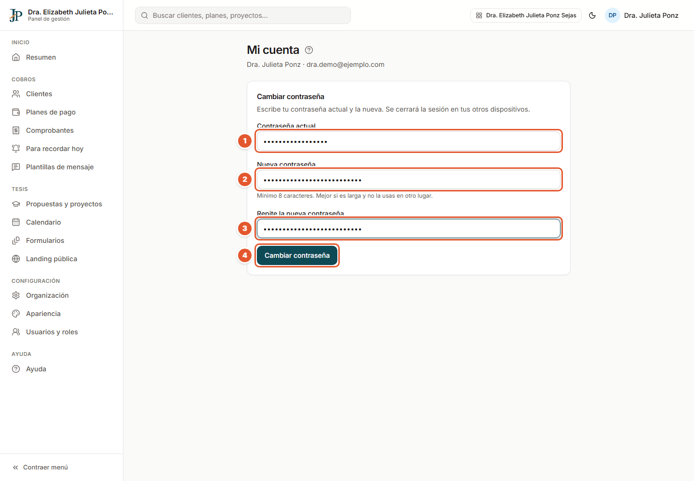

**Si la olvidaste:**

1. En la pantalla de entrada, haz clic en **¿Olvidaste tu contraseña?**

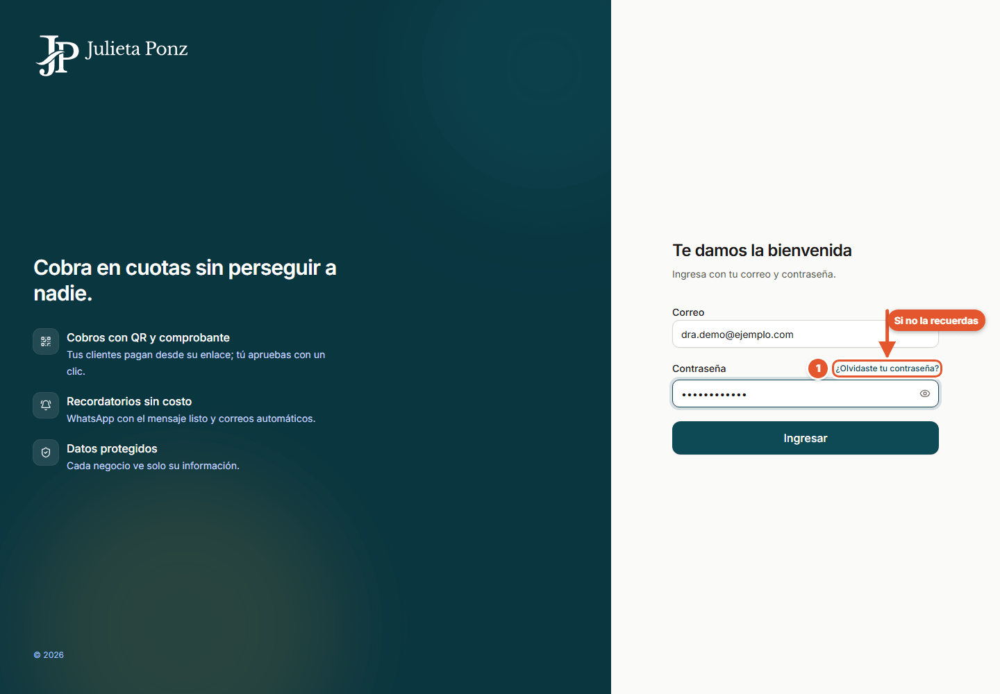

2. Escribe tu correo (1) y haz clic en **Enviar enlace** (2).

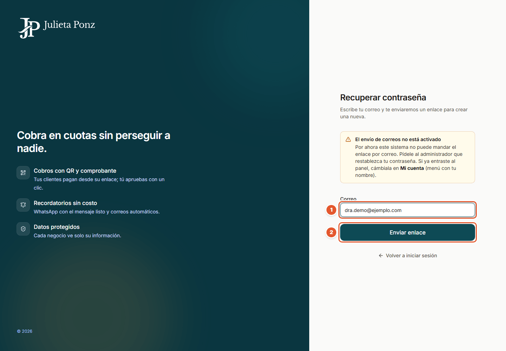

3. Abre el correo que te llega y haz clic en el enlace. **Vence en 1 hora.**
4. Escribe tu nueva contraseña dos veces y guárdala.

> **Consejo:** usa una contraseña larga, de al menos 12 caracteres, que no uses en otro lugar.

> **Importante:** si en esa pantalla ves el aviso **«El envío de correos no está activado»**, el sistema todavía no puede mandar correos: pídele a Fernando que restablezca tu contraseña (lo hace desde el servidor en un minuto). Si el correo está activado pero no llega, revisa la carpeta de *spam*.

### Conocer el panel {#conocer-el-panel}

Al entrar ves el **Resumen**. Tiene cinco partes:

1. **Menú** a la izquierda: todas las secciones, agrupadas en Cobros, Tesis, Configuración y Ayuda.
2. **Buscador**: encuentra un cliente, un plan o un proyecto por su nombre.
3. **Indicadores**: cuánto cobraste este mes, cuánto falta cobrar, cuánto está vencido y cuántos planes están en cola.
4. **Para recordar hoy**: a quién conviene escribirle hoy, con el botón de WhatsApp listo.
5. **Comprobantes por aprobar**: los pagos que subieron tus estudiantes.

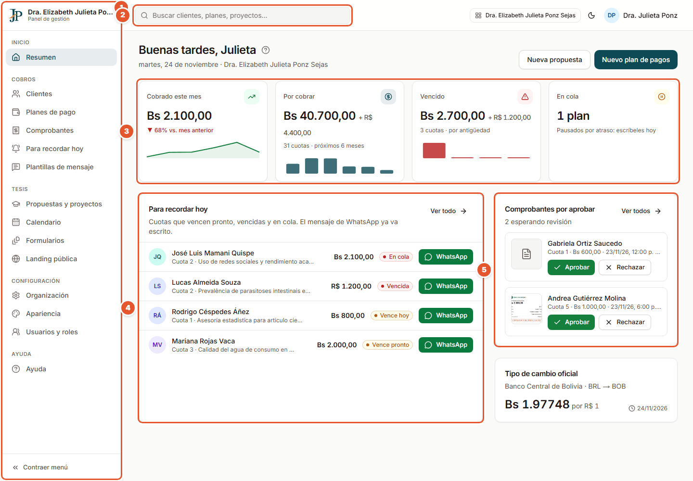

Los cuatro indicadores, en detalle:

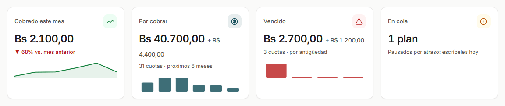

- **Cobrado este mes**: pagos que aprobaste este mes, en bolivianos. La flecha compara con el mes anterior.
- **Por cobrar**: todas las cuotas pendientes. Si tienes planes en reales, verás el monto en R$ aparte.
- **Vencido**: cuotas cuya fecha ya pasó y todavía no están pagadas.
- **En cola**: planes pausados porque el estudiante superó los días de gracia. Escríbeles hoy.

En el celular, el menú está abajo (Inicio, Clientes, Recordar, Tesis) y el botón **Más** abre el resto.

Arriba a la derecha está **tu nombre**. Al hacer clic se abre un menú con:

1. **Modo oscuro**: fondo oscuro, más cómodo de noche.
2. **Mi cuenta y contraseña**: para cambiar tu contraseña.
3. **Ayuda**: este manual.
4. **Cerrar sesión**: hazlo siempre si usas una computadora prestada.

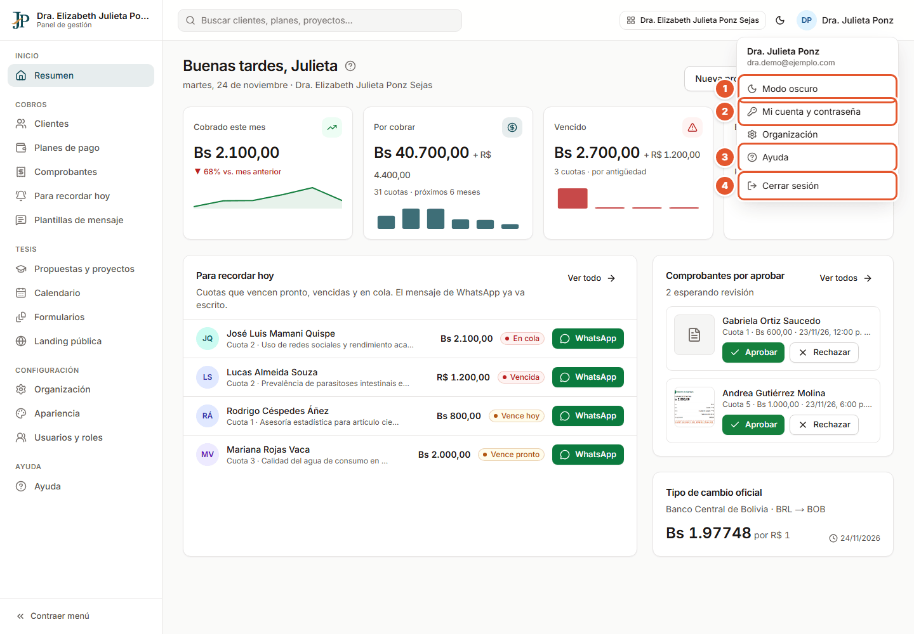

### La ayuda dentro del sistema {#ayuda}

Este manual también está dentro del panel:

- En el menú, **Ayuda** (1) abre el manual completo. Escribe una palabra en el buscador (2), por ejemplo «comprobante», y verás solo los temas que la mencionan.

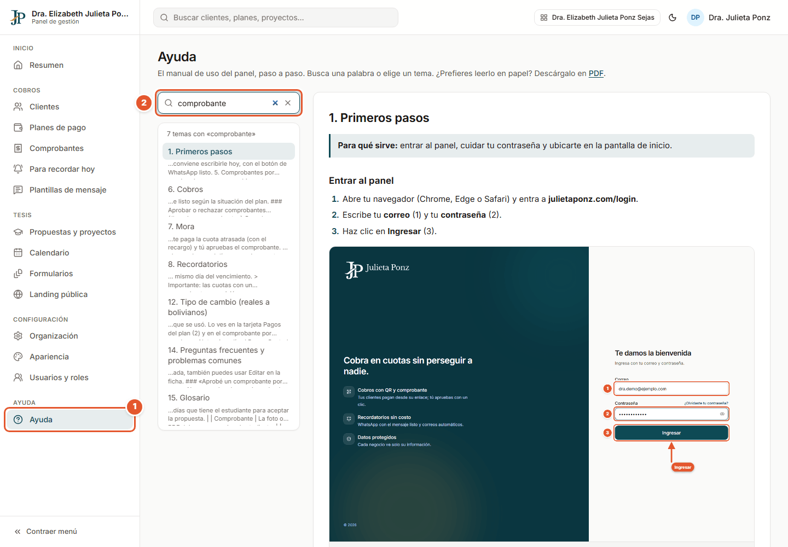

- En cada pantalla principal hay un **?** junto al título. Te lleva directo a la parte del manual que explica esa pantalla.

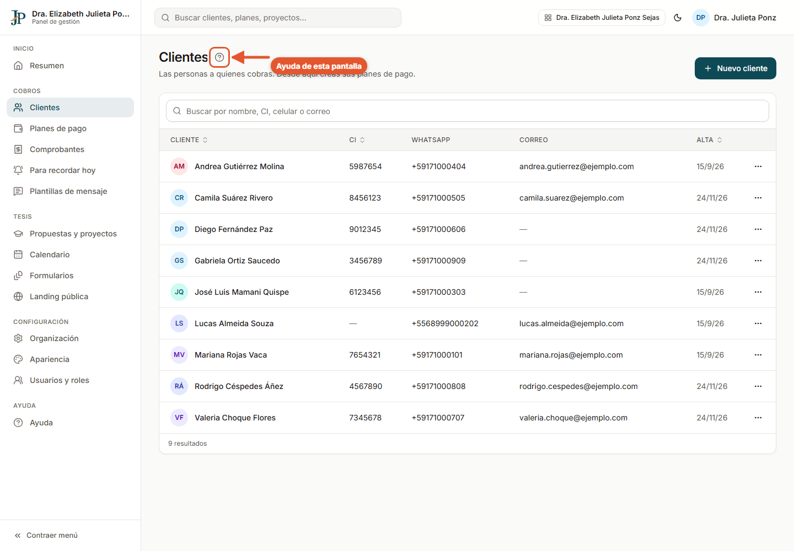

### Buscar cualquier cosa {#buscar}

Escribe en el **buscador** de arriba (un nombre, un CI o parte del tema) y presiona **Enter**. Verás los clientes, planes y proyectos que coinciden.

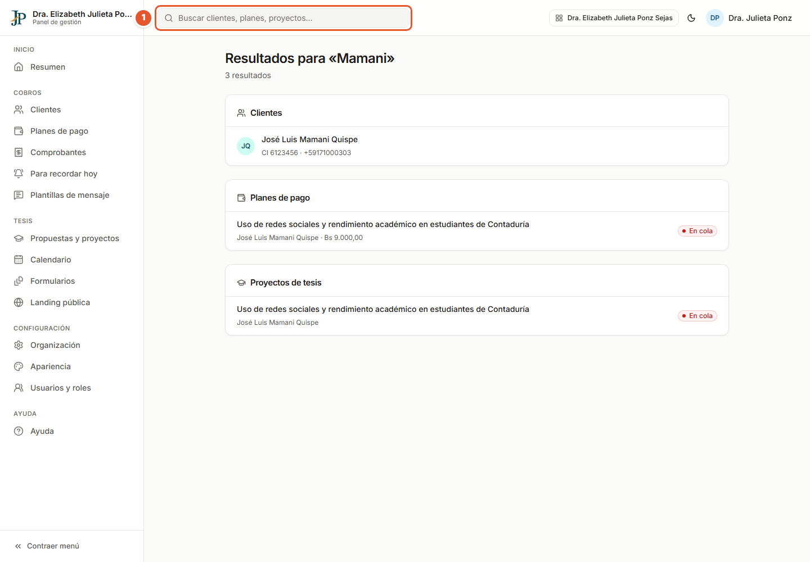

## 2. Configurar tu cuenta {#configurar-cuenta}

**Para qué sirve:** dejar listos los datos que ven tus estudiantes al pagar y el aspecto de tu página web.

> **Consejo:** hazlo una sola vez, antes de enviar tu primera propuesta.

### Datos de la organización, QR de pago, banco y WhatsApp {#datos-organizacion}

1. En el menú, entra a **Configuración → Organización**.
2. Revisa el **Nombre** (1). Es el que ven tus estudiantes en su portal.
3. Escribe tu **WhatsApp** (2) con el código de país y solo números. Ejemplo: `59171234567`.
4. Escribe tus **Datos bancarios** (3): banco, número de cuenta y titular. Aparecen junto al QR.
5. En **Imagen del QR estático de cobro** (4), elige la foto de tu QR (PNG, JPG o WEBP). Puedes sacarla de la app de tu banco.
6. Haz clic en **Guardar** (5).

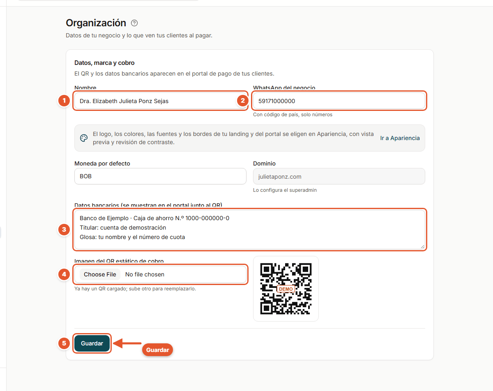

> **Importante:** el QR debe ser **estático** (sin monto fijo). El estudiante escribe el monto exacto que le muestra su portal.

> **Nota:** el **Dominio** (julietaponz.com) no se cambia desde aquí: lo configura Fernando.

### Apariencia: colores, fuentes e intro {#apariencia}

Aquí eliges cómo se ven tu **página web** y el **portal de tus estudiantes**. El panel mantiene su diseño y solo toma tu color principal.

1. Entra a **Configuración → Apariencia**.
2. Elige una **combinación lista** (1). Todas se leen bien. A la derecha ves la **vista previa en vivo** (2).

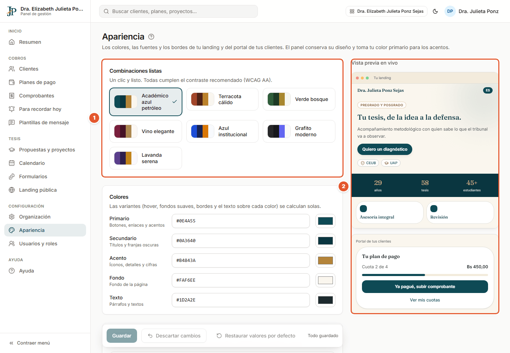

3. Si quieres, ajusta cada **color** (primario, secundario, acento, fondo y texto). Puedes escribir el código (por ejemplo `#0E4A55`) o elegirlo con el cuadrito de color.

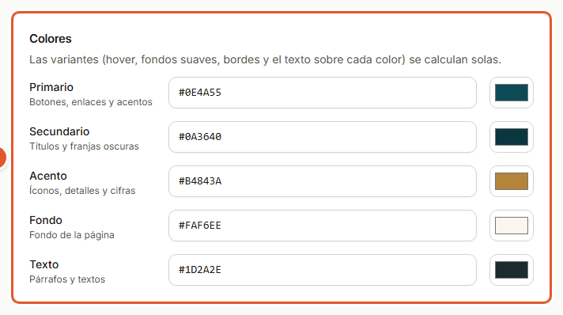

4. Debajo está el control de **Contraste**. Si alguna combinación no se lee bien, aparece en rojo y el botón **Usar sugerencia** la corrige con un clic. Mientras haya algo en rojo no se puede guardar.
5. Elige la **fuente de los títulos**, la **fuente del texto** y la forma de los **bordes** (recto, suave o redondeado).

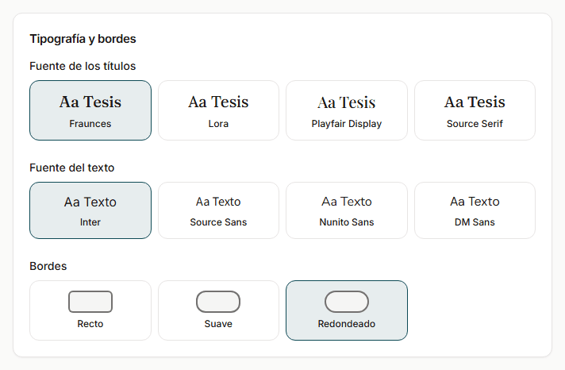

6. En **Intro de la landing** decide si quieres la presentación animada con tu monograma (1). Dura unos 2 segundos y se puede saltar.
7. Haz clic en **Guardar** (2). Si no te convence, usa **Descartar cambios** o **Restaurar valores por defecto**.

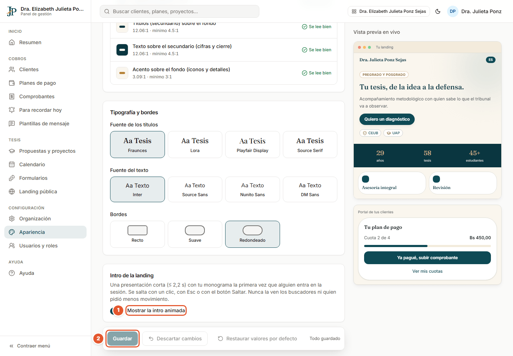

### Logo e isotipo {#logo}

Al final de **Apariencia** está **Logo e isotipo**. Por defecto se usa tu monograma JP.

1. Para el **logo completo** (encabezado de la página, PDF y correos), elige el archivo y haz clic en **Subir** (1).
2. Para el **isotipo** (el símbolo pequeño: celular, portal, panel), elige el archivo y haz clic en **Subir** (2).
3. Para volver al original, usa **Usar el de por defecto**.

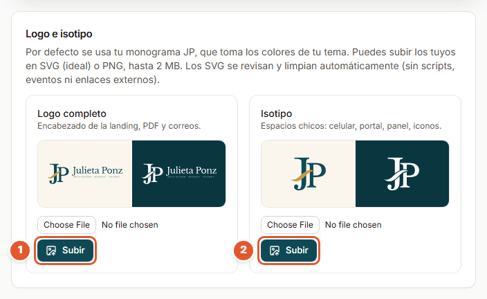

> **Consejo:** el mejor formato es **SVG**. También sirve PNG, de hasta 2 MB. Ves cómo queda sobre fondo claro y oscuro.

### Foto de la portada {#foto}

Tu foto aparece en la portada de julietaponz.com, junto al título.

1. Entra a **Tesis → Landing pública**. Arriba está **Foto de la portada**.
2. Haz clic en **Elegir la foto** (1) y busca la foto en tu computadora o celular: JPG, PNG o WEBP, hasta 15 MB.
3. Haz clic en **Subir foto** (2).

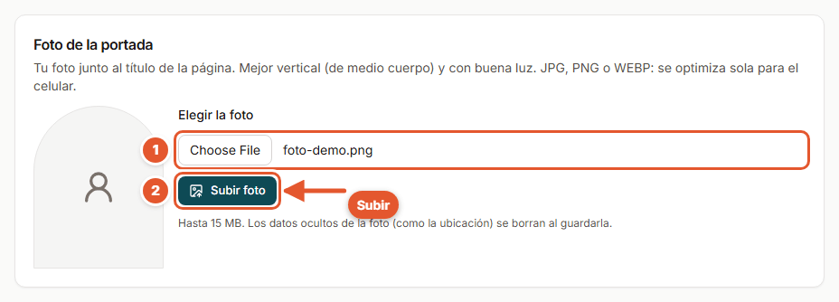

4. Verás la foto en el recuadro (1). Para cambiarla, sube otra; para sacarla, **Quitar foto** (2).

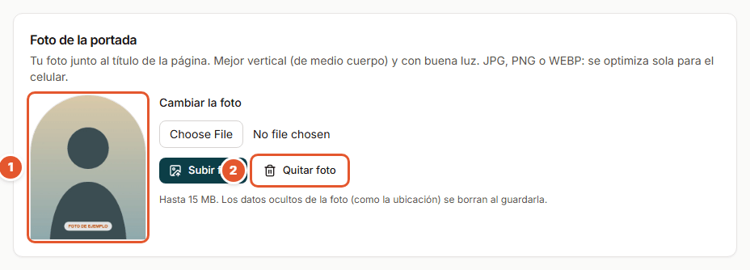

5. Abre tu página para ver cómo quedó (1).

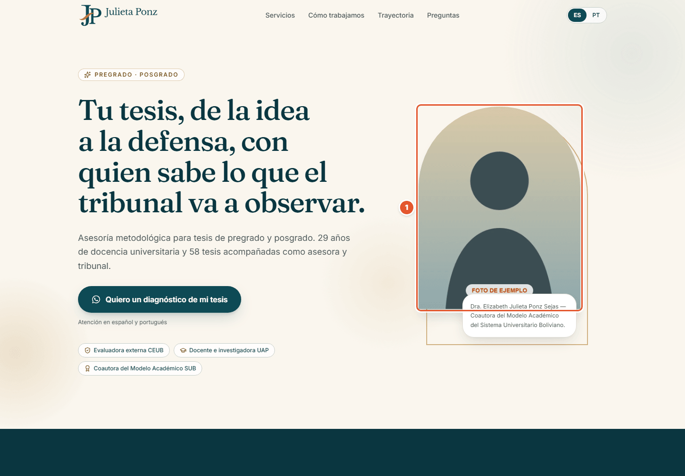

> **Consejo:** usa una foto **vertical**, de medio cuerpo, con buena luz y fondo simple. El sistema la achica sola para que cargue rápido en el celular y le borra los datos ocultos (como el lugar donde se tomó).

### Textos de la página web, en español y portugués {#landing}

Todos los textos de julietaponz.com se editan desde el panel.

1. Entra a **Tesis → Landing pública**.
2. Elige el idioma (1): **Español** o **Português**. Cada idioma se guarda por separado.
3. Cambia los textos de cada sección (portada, cifras, servicios, preguntas frecuentes…).
4. Haz clic en **Guardar textos** (3). Para ver el resultado, usa **Ver la página** (2).

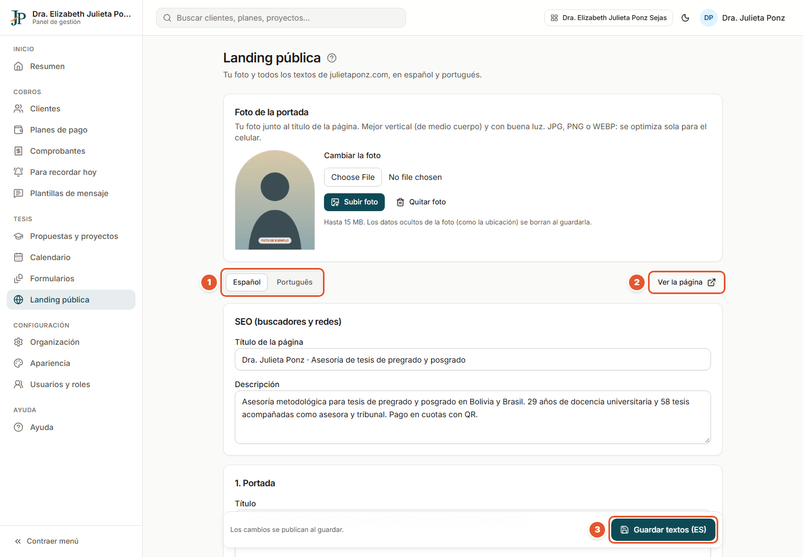

En los campos largos, cada **línea** es un elemento. Cuando el campo dice «número | texto» o «pregunta | respuesta», separa las dos partes con una barra vertical `|`.

> **Importante:** guarda primero en español, cambia a «Português» y guarda también allí. Si cambias de idioma sin guardar, pierdes lo escrito.

### Testimonios {#testimonios}

La sección de testimonios **no aparece** en tu página mientras esté vacía.

1. En **Landing pública**, baja hasta **9. Testimonios**.
2. Escribe un testimonio por línea, así: `lo que dijo el estudiante | nombre y carrera` (1).
3. Haz clic en **Guardar textos**.

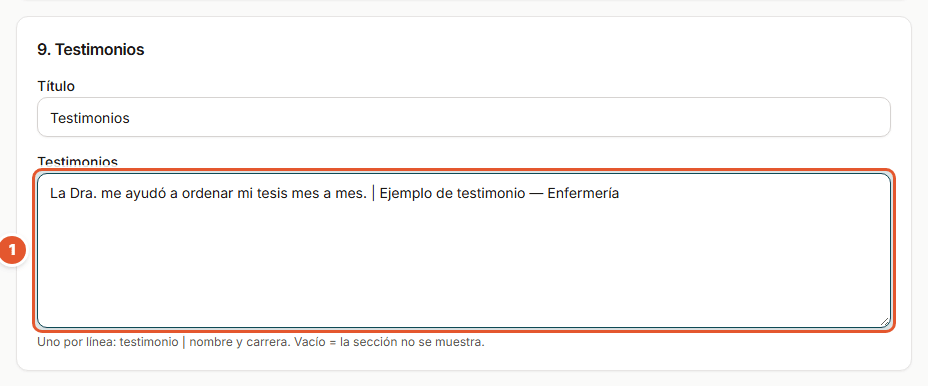

> **Consejo:** pide permiso a cada estudiante antes de publicar su nombre.

## 3. Clientes y estudiantes {#clientes}

**Para qué sirve:** tener los datos de cada persona a quien cobras (nombre, CI, WhatsApp y correo) en un solo lugar.

Un **estudiante** es un cliente. Puedes crearlo aquí o directamente al armar una propuesta (paso 1).

### Ver y buscar clientes

1. En el menú, entra a **Cobros → Clientes**. Ves la lista con su CI, WhatsApp y correo.
2. Para encontrar a alguien, escribe parte del nombre, el CI, el celular o el correo en el buscador (2).

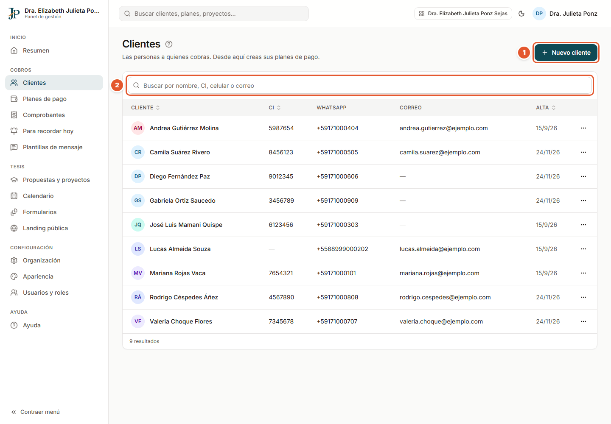

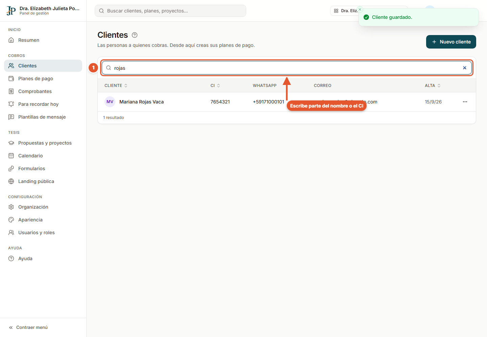

### Crear un cliente

1. Haz clic en **Nuevo cliente** (1 en la lista).
2. Escribe el **nombre completo** (1). Es el único dato obligatorio.
3. Escribe el **CI** (2). Lo usará para entrar a su portal.
4. Escribe el **celular de WhatsApp con código de país** (3). Ejemplo: `59171234567` (Bolivia) o `5568999999999` (Brasil).
5. Escribe el **correo** (4) si quieres que reciba recordatorios automáticos.
6. Haz clic en **Agregar cliente** (5).

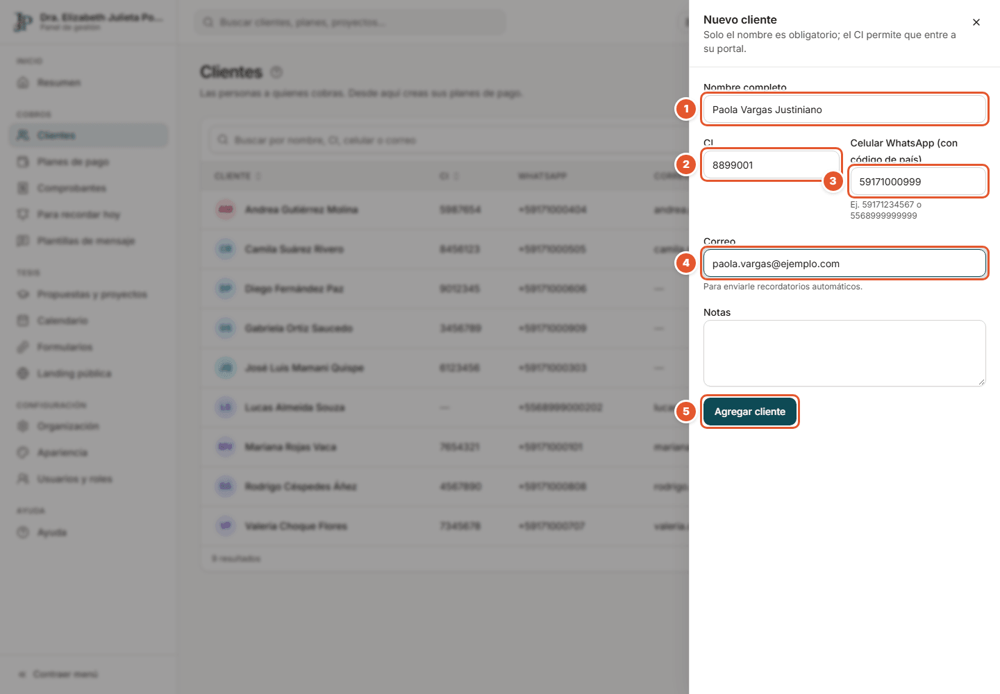

> **Importante:** sin el **código de país**, el botón de WhatsApp abre un número equivocado.

### Editar un cliente

1. Haz clic en el nombre del cliente. Se abre su **ficha**.
2. A la izquierda ves sus **planes de pago** (1) y cuánto lleva pagado.
3. A la derecha están sus **datos** (2). Corrige lo que necesites y haz clic en **Guardar cambios** (3).

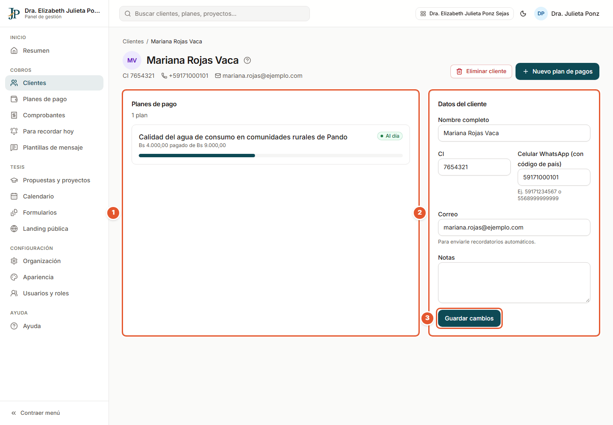

### Eliminar un cliente {#eliminar-cliente}

Útil para borrar datos de prueba o a alguien que cargaste por error.

1. Abre la **ficha** del cliente y haz clic en **Eliminar cliente** (1).

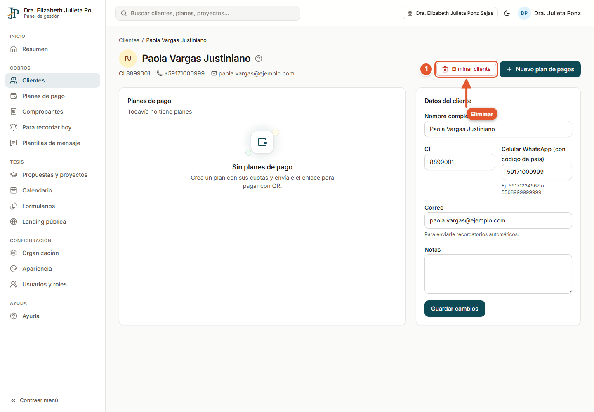

2. Lee el aviso (1): dice todo lo que se va a borrar. Si estás segura, haz clic en **Sí, eliminar** (2).

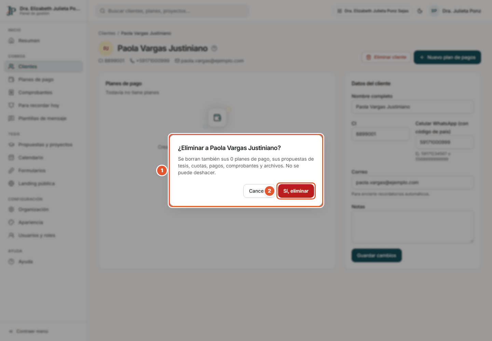

3. Vuelves a la lista con el aviso **Cliente eliminado** (1).

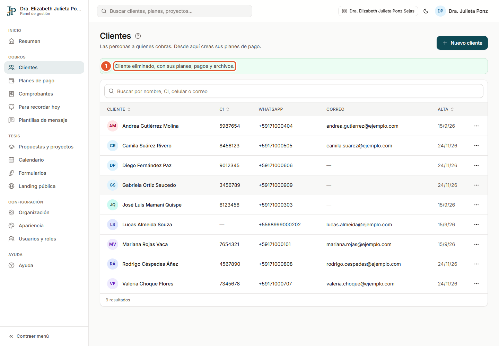

> **Importante:** eliminar un cliente borra **también** sus planes de pago, sus propuestas de tesis, cuotas, pagos, comprobantes y archivos. **No se puede deshacer.** Si solo quieres que deje de entrar a su portal, mejor **anula su enlace** (ver [Cobros](#portal)).

## 4. Crear una propuesta paso a paso {#crear-propuesta}

**Para qué sirve:** armar en 10 pasos la propuesta de asesoría (plan de pagos, cronograma y condiciones) que el estudiante revisa y acepta desde su celular.

Vamos a seguir un **ejemplo completo**: la tesis de **Sofía Méndez Arteaga**, de 5 meses, con cuotas de **Bs 2.000, 2.000, 2.000, 2.000 y 1.000** (total Bs 9.000).

### La lista de propuestas y proyectos {#propuestas}

En el menú, entra a **Tesis → Propuestas y proyectos**. Ves todas las tesis con su estado. Puedes filtrarlas por **Estado** (2). Para empezar una nueva, haz clic en **Nueva propuesta** (1).

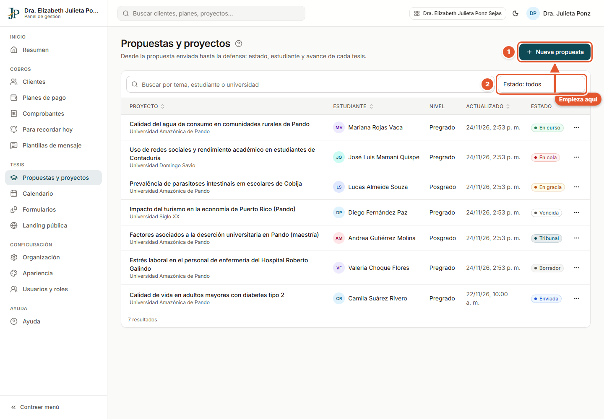

Arriba ves los **10 pasos**. Puedes ir a cualquiera haciendo clic en su nombre. El paso en verde ya está completo; el rojo tiene algo por corregir. A la derecha, el **Resumen** se actualiza mientras escribes.

> **Consejo:** si te interrumpen, usa **Guardar borrador** en cualquier paso. La propuesta queda guardada y la terminas después.

### Paso 1: Datos

1. Escribe el **nombre del proyecto o tema** (2): «Estrategias de aprendizaje y rendimiento académico en estudiantes de Enfermería».
2. En **Estudiante**, elige **Nuevo** (3) si es la primera vez que trabajas con esa persona, o **Existente** para elegirla de la lista.
3. Escribe el nombre, el **CI** (4), el WhatsApp con código de país y el correo.
4. Escribe la universidad y elige el **Nivel** (5): pregrado o posgrado.
5. Haz clic en **Siguiente** (6).

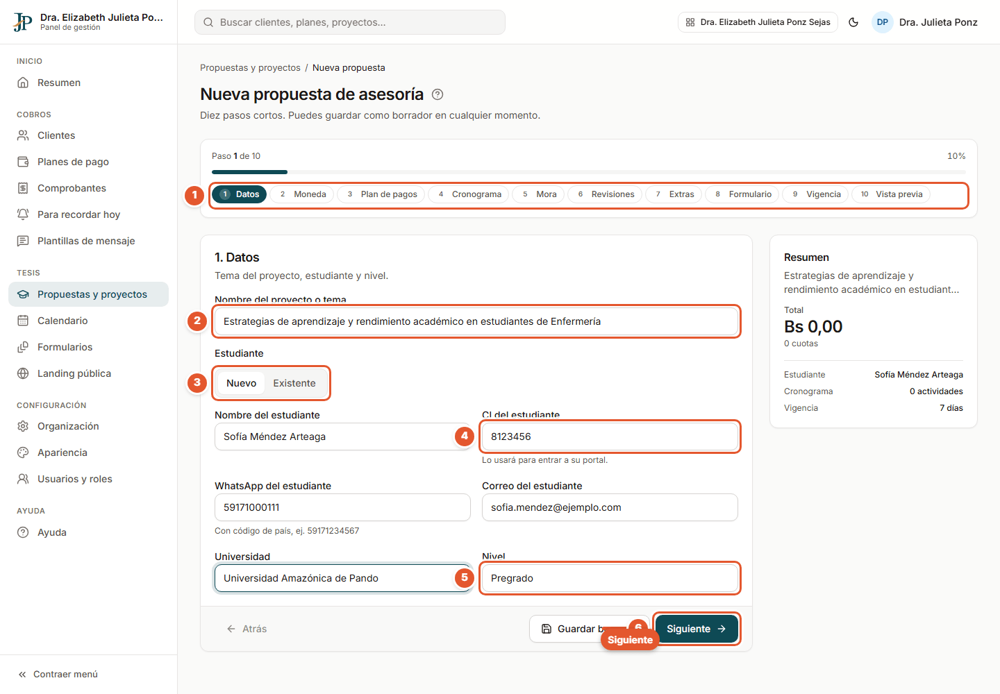

### Paso 2: Moneda

Elige **Bolivianos (BOB)** o **Reales (BRL)** (1). En el ejemplo, bolivianos.

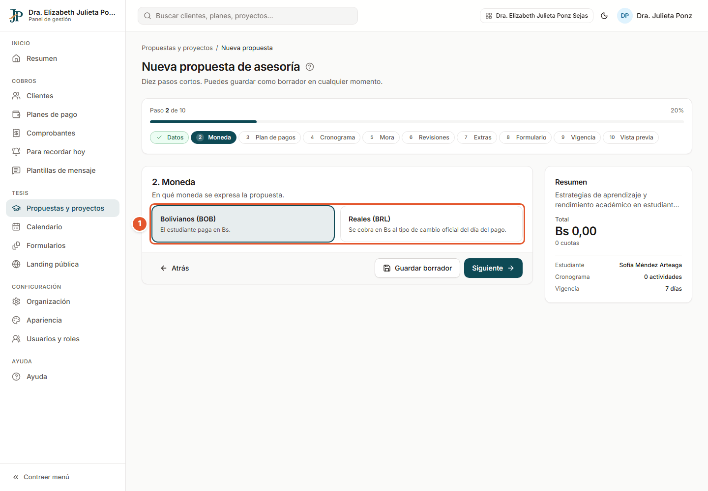

> **Nota:** si eliges reales, el estudiante igual paga en bolivianos con el QR. El monto se calcula con el tipo de cambio oficial del día en que paga (ver [Tipo de cambio](#tipo-cambio)).

### Paso 3: Plan de pagos

Primero se generan las cuotas y después se ajustan:

1. En **N.º de cuotas** escribe `5` (1).
2. En **Total** escribe `9000` (2).
3. En **1.ª fecha** elige el día de la primera cuota (3). Las demás quedan un mes después de la anterior.
4. Haz clic en **Generar** (4). Aparecen 5 cuotas de Bs 1.800.

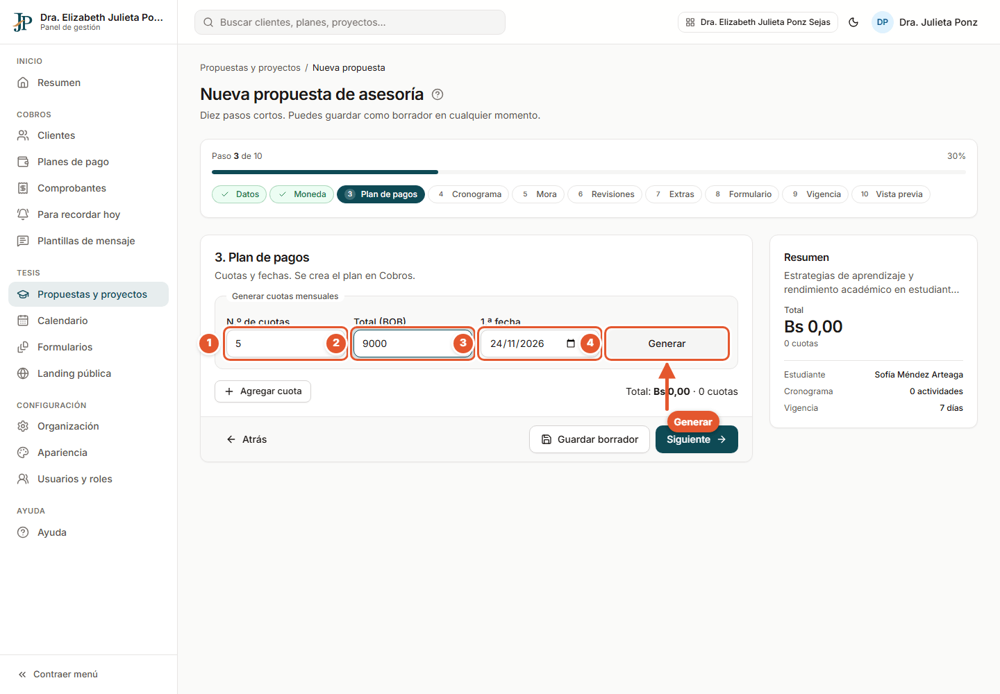

5. Cambia los montos: escribe `2000` en las cuatro primeras y `1000` en la última (1).
6. Si quieres, cambia la **fecha** de cualquier cuota (2) o agrega una con **Agregar cuota** (3). El ícono de basurero quita una cuota.
7. Comprueba el **Total** abajo (4): **Bs 9.000,00**.

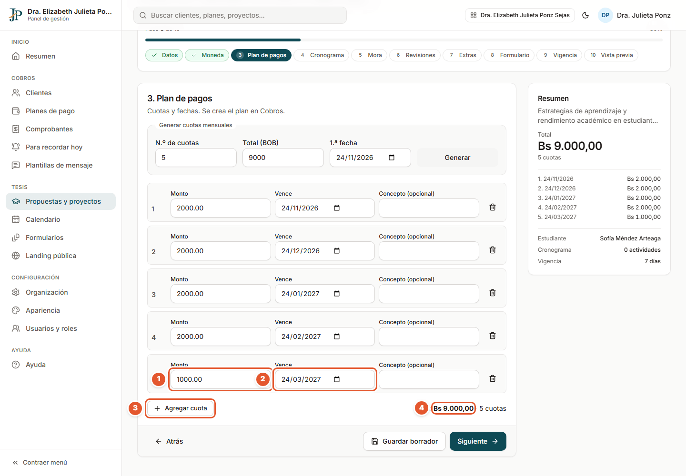

> **Consejo:** el campo **Concepto** es opcional. Sirve para aclarar una cuota, por ejemplo «Matrícula» o «Saldo final».

### Paso 4: Cronograma

1. Haz clic en **Cargar plantilla** (1). Se cargan las 9 actividades de siempre, repartidas en los 5 meses.
2. Marca o desmarca las casillas de cada mes (2) para mover una actividad.
3. La columna **Estudiante** indica qué actividades le tocan al estudiante (recolección de datos y defensa).
4. Para sumar otra actividad, usa **Agregar actividad** (3).

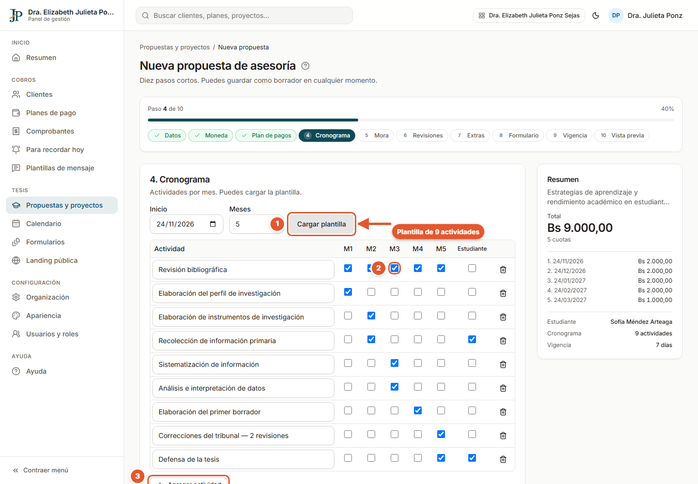

> **Nota:** la fecha de **Inicio** marca el mes 1. Más adelante, el avance del proyecto se calcula con las actividades que marques como hechas.

### Paso 5: Mora

Aquí decides qué pasa si el estudiante se atrasa. Todo es opcional.

1. **Plazo para pagar la 1.ª cuota tras aceptar** (1): días que tiene para pagar la primera cuota después de aceptar.
2. **Días de gracia** (2): días de atraso que toleras antes de pausar el proyecto (por ejemplo, 5).
3. **Gracia en una nueva mora** (3): días de gracia si vuelve a atrasarse más adelante (por ejemplo, 10).
4. **Aplicar recargo por mora** (4): márcalo si quieres cobrar un recargo.
5. **Recargo (%)** (5): por ejemplo, 5 %.
6. **Aplicación** (6): **única** (una sola vez por cuota) o **por cada mes de atraso**.

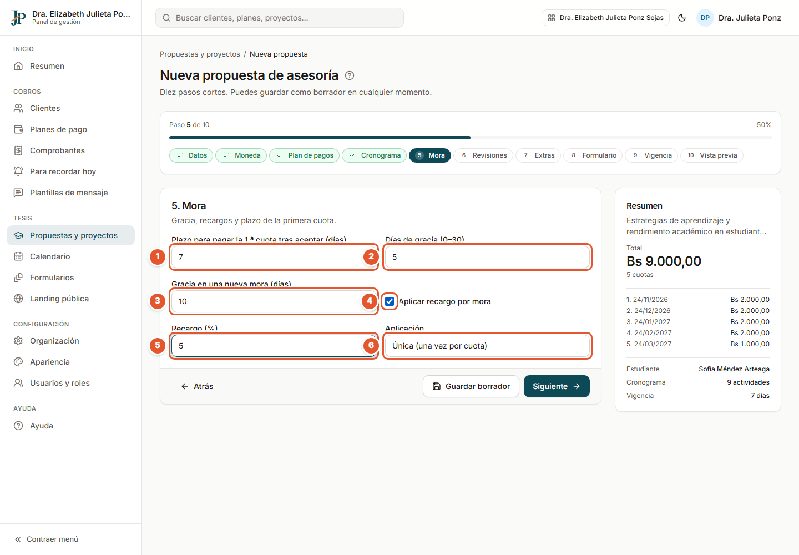

Más detalles en la sección [Mora](#mora).

### Paso 6: Revisiones del tribunal

Las **dos primeras revisiones están incluidas**. Escribe el **precio de la 3.ª revisión** (1), que solo se cobra si el estudiante la pide. En el ejemplo, `500`.

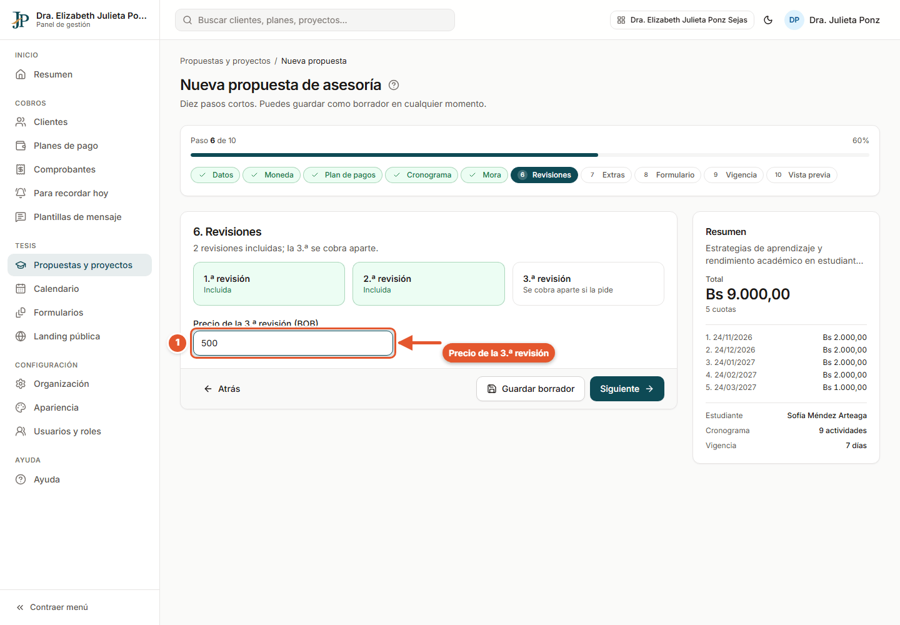

### Paso 7: Extras

Ya viene cargado **Diapositivas para la sustentación** (1) con su precio (2). Cambia el precio si quieres, quítalo con el basurero o suma otro con **Agregar extra** (3).

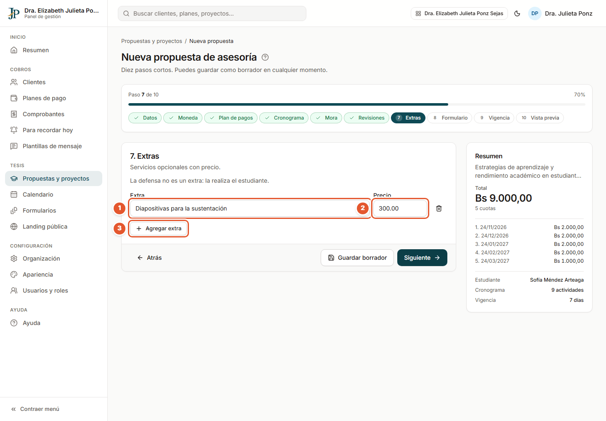

> **Nota:** la defensa **no** es un extra: la hace el estudiante.

### Paso 8: Formulario

Elige el **formulario de recolección de datos** (1) que el estudiante completará después de aceptar. Si todavía no creaste ninguno, déjalo en «Sin formulario» (ver [Formularios](#formularios)).

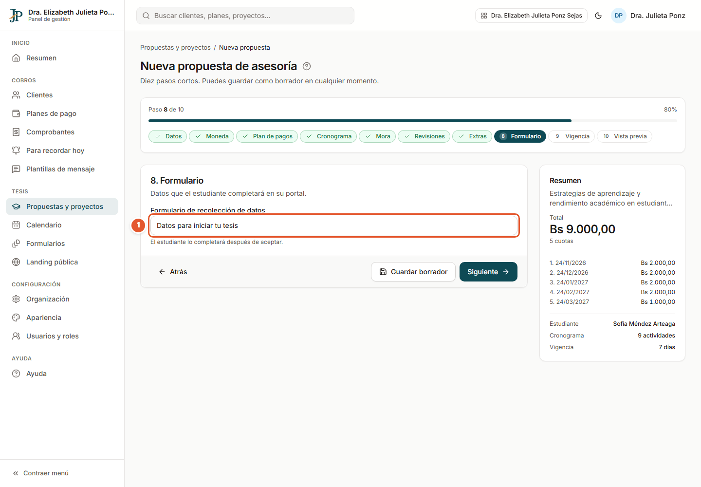

### Paso 9: Vigencia

Escribe cuántos **días** tiene el estudiante para aceptar (1). Puede ser de 1 a 90. En el ejemplo, 7 días.

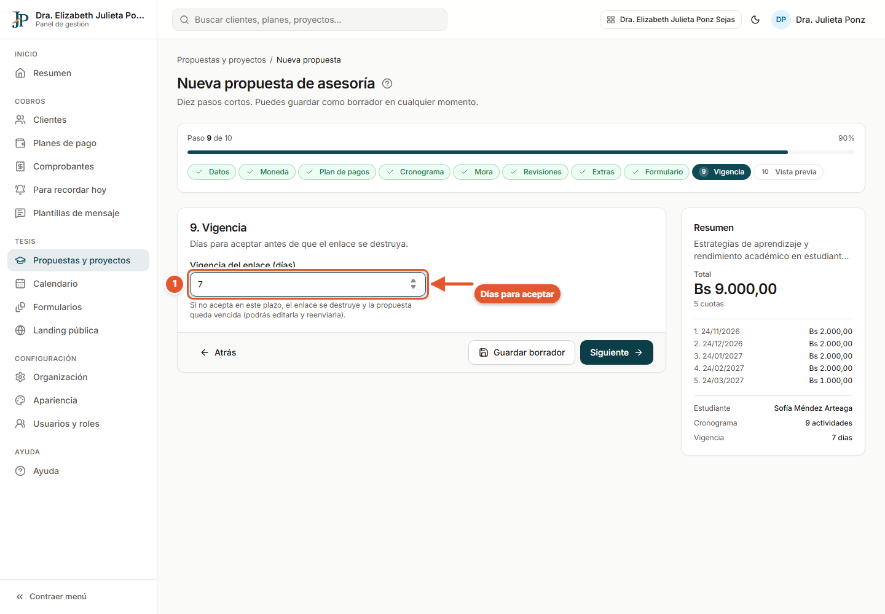

### Paso 10: Vista previa

1. Revisa el resumen (1): proyecto, estudiante, plan de pagos (5 cuotas, Bs 9.000), cronograma, 3.ª revisión, extras y vigencia.
2. Si algo está mal, haz clic en el paso correspondiente arriba y corrígelo.
3. Haz clic en **Guardar propuesta** (2).

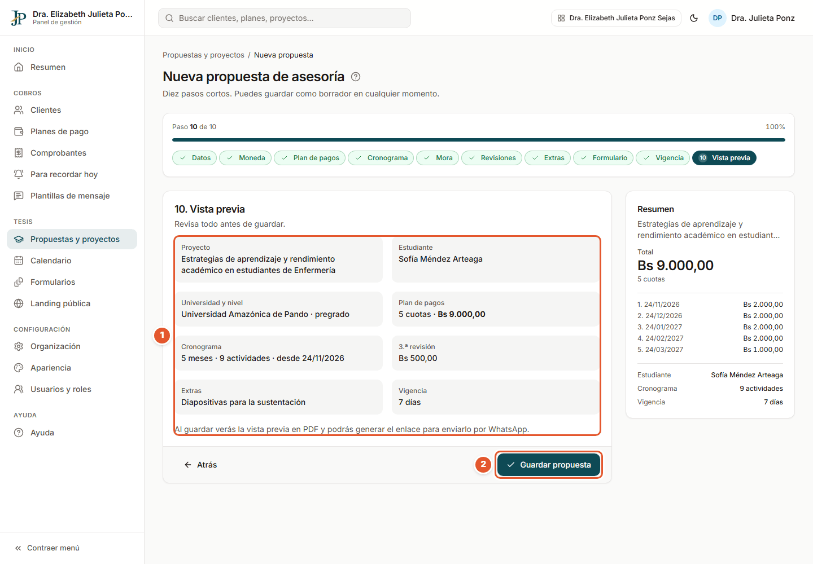

Se abre la **ficha** de la propuesta, en estado **Borrador**. Desde aquí:

1. **Ver PDF** (1): abre la propuesta en PDF, con tu logo, para revisarla o descargarla.
2. **Editar** (2): vuelve a los 10 pasos.
3. **Forma de acceso** (3): con el **CI** del estudiante o con un **PIN**.
4. **Generar enlace y enviar** (4): ver la sección siguiente.

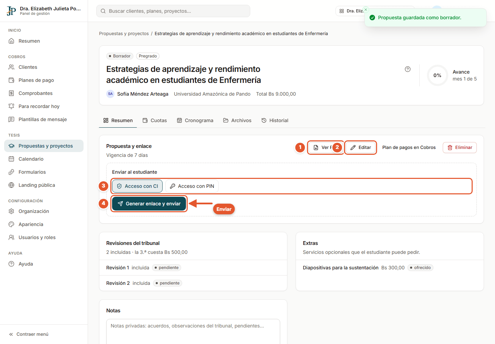

## 5. Enviar la propuesta por WhatsApp {#enviar-propuesta}

**Para qué sirve:** mandarle al estudiante un enlace personal y privado para que revise y acepte la propuesta desde su celular.

### Generar el enlace y enviarlo

1. En la ficha de la propuesta, elige **Acceso con CI** (recomendado) o **Acceso con PIN**.
2. Haz clic en **Generar enlace y enviar**.
3. Aparece el **enlace** (1). Haz clic en **Enviar por WhatsApp** (2): se abre WhatsApp con el mensaje ya escrito.
4. Revisa el mensaje y presiona **Enviar** en WhatsApp.

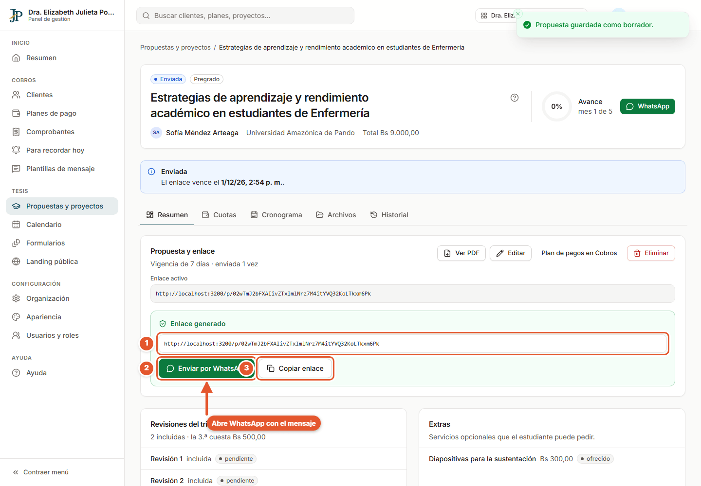

> **Consejo:** si prefieres mandarlo por otro medio (correo, Telegram), usa **Copiar enlace** (3) y pégalo donde quieras.

> **Importante:** si elegiste **PIN**, el número de 6 dígitos aparece **una sola vez**. Anótalo y envíaselo al estudiante junto con el enlace.

### Vigencia del enlace

Después de enviarla, la ficha muestra hasta cuándo puede aceptar (1). Pasada esa fecha, el enlace deja de funcionar.

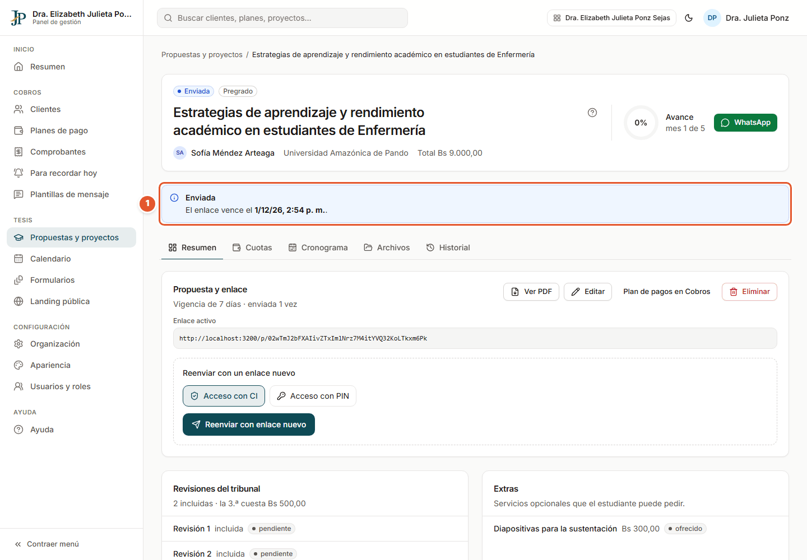

> **Consejo:** si faltan pocos días y no aceptó, el botón de WhatsApp de la ficha trae un mensaje de «propuesta por vencer» para recordárselo.

### Si la propuesta vence: editarla y reenviarla {#editar-reenviar}

Si el estudiante no acepta a tiempo, **el enlace se destruye**, pero **la propuesta queda guardada** en estado **Vencida** (1). No pierdes nada.

1. Abre la propuesta vencida desde **Propuestas y proyectos**.
2. Si hace falta, haz clic en **Editar** (2) y cambia lo que quieras: montos, fechas, actividades, moneda o extras.
3. Haz clic en **Reenviar con enlace nuevo** (3) y envíalo por WhatsApp como la primera vez.

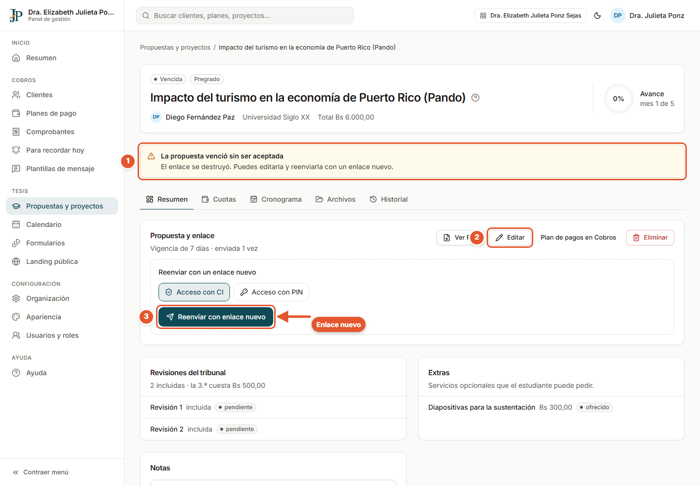

Al editar, ves los mismos 10 pasos (1). Haz clic en **Guardar cambios** (2) cuando termines.

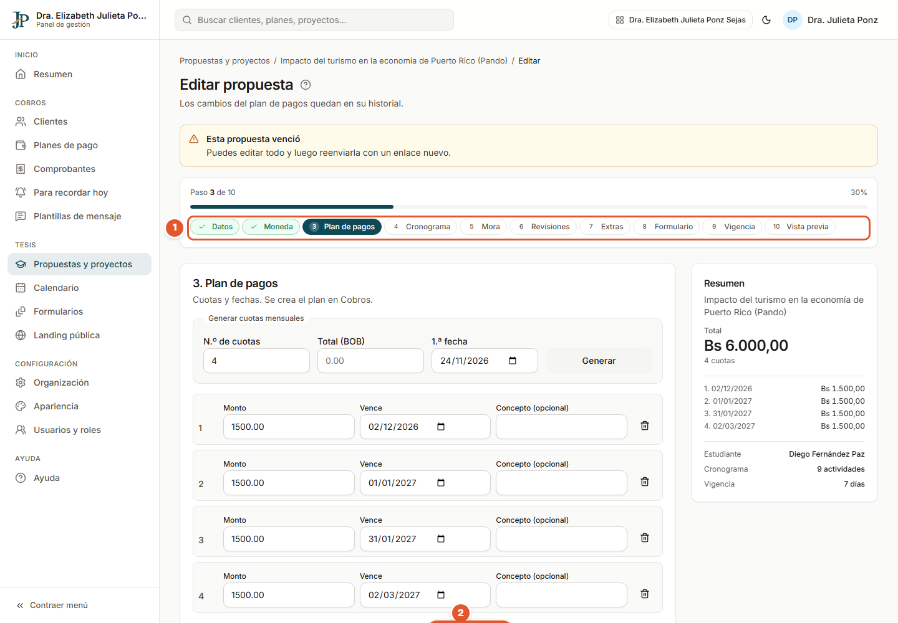

> **Importante:** cada enlace nuevo **anula el anterior**. Si el estudiante abre un enlace viejo, verá «Enlace no disponible».

> **Nota:** una propuesta solo se puede editar mientras no esté aceptada. Después, los cambios de fechas y montos se hacen en el plan de pagos (ver [Cobros](#cobros)) y los del cronograma con un [cronograma nuevo](#mora).

### Eliminar una propuesta {#eliminar-propuesta}

En la ficha de la propuesta, tarjeta **Propuesta y enlace**, haz clic en **Eliminar** (1) y confirma con **Sí, eliminar**.

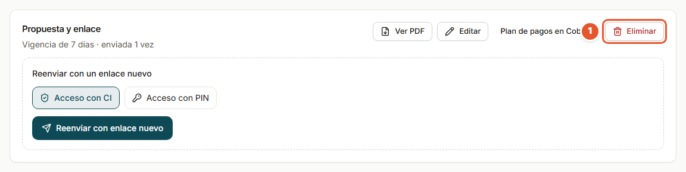

Se borra la propuesta con su cronograma, revisiones, extras, archivos, respuestas y **su plan de pagos** (cuotas, pagos y comprobantes). El enlace deja de funcionar. El estudiante **sigue** en Clientes: si también quieres borrarlo, elimínalo desde su ficha.

> **Importante:** no se puede deshacer. Si la propuesta solo venció, no hace falta borrarla: puedes [editarla y reenviarla](#editar-reenviar).

## 6. Cobros {#cobros}

**Para qué sirve:** ver las cuotas de cada plan, aprobar los pagos y ajustar fechas o montos cuando haga falta.

Cada propuesta crea automáticamente un **plan de pagos**. También puedes crear planes sin tesis (cursos, talleres, asesorías sueltas).

### Lista de planes

En el menú, entra a **Cobros → Planes de pago**. Ves cada plan con su cliente, cuánto lleva pagado, el total y el estado. Busca por concepto o cliente (1) o filtra por **Estado** (2): al día, en gracia o en cola. Para crear uno nuevo, usa **Nuevo plan** (3).

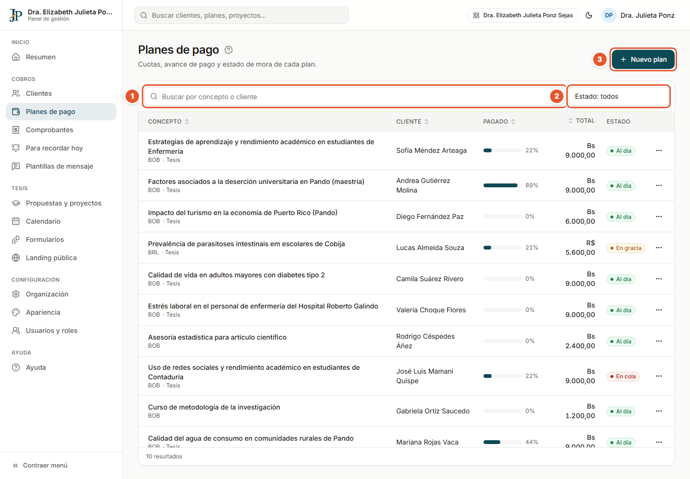

### Ver las cuotas de un plan

Haz clic en un plan. Verás:

1. **Cuotas**: número, fecha, monto, recargo y estado (pagada, pendiente, vencida, en cola o en revisión).
2. **Resumen**: total, pagado, recargos y saldo.
3. **Portal del cliente**: el enlace privado del estudiante (ver abajo).
4. **WhatsApp**: abre un mensaje listo según la situación del plan.

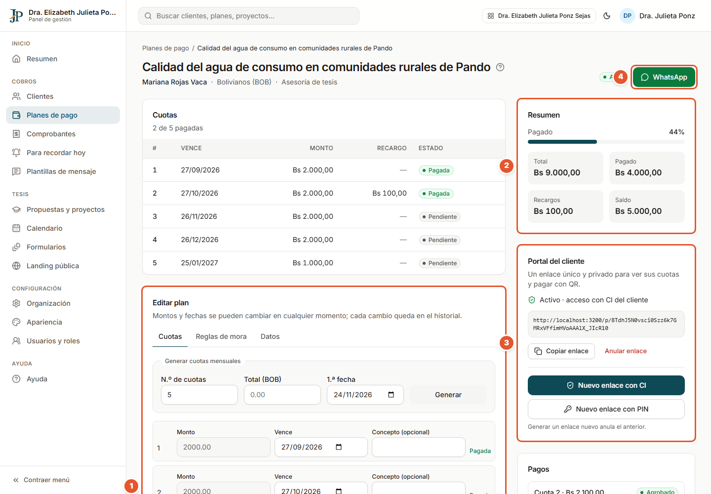

### Aprobar o rechazar comprobantes {#aprobar-comprobantes}

Cuando un estudiante sube su comprobante, aparece en **Cobros → Comprobantes** y en el inicio.

1. Haz clic en la imagen o en **Ver comprobante** (1) para verlo en grande.
2. Comprueba que el **monto** y la **fecha** coincidan con lo que llegó a tu cuenta.
3. Si está bien, haz clic en **Aprobar** (2). La cuota queda **pagada** al instante.
4. Si algo no cuadra, haz clic en **Rechazar** (3).

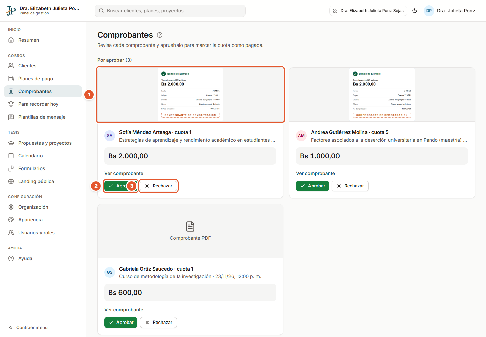

Al rechazar, escribe el **motivo** (1) con claridad y haz clic en **Confirmar rechazo** (2). El estudiante lo ve en su portal y puede subir otro.

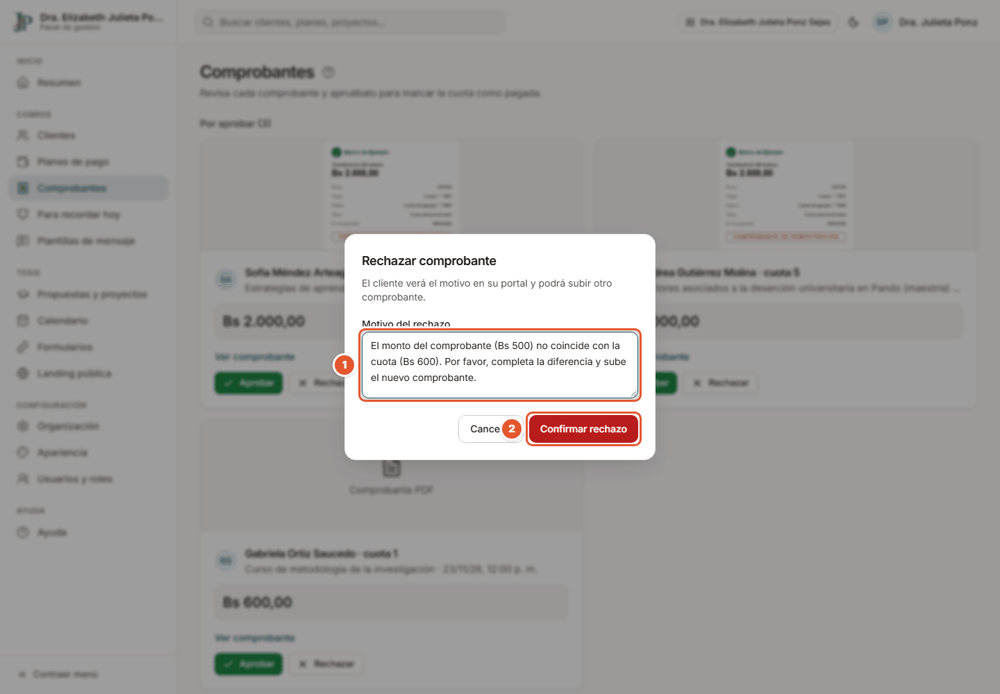

Arriba aparece la confirmación (1) y abajo, la lista de **revisados recientemente** (2).

> **Importante:** revisa siempre tu app del banco antes de aprobar. Aprobar marca la cuota como pagada.

> **Consejo:** mientras un comprobante está en revisión, esa cuota no acumula mora. Revísalos pronto para que tus indicadores estén al día.

### Editar fechas y montos {#editar-cuotas}

Puedes cambiar fechas y montos **en cualquier momento**, incluso con el plan en curso.

1. Abre el plan y baja hasta **Editar plan**. Elige la pestaña **Cuotas** (1).
2. Cambia la **fecha** (2) o el **monto** de la cuota que necesites.
3. Haz clic en **Guardar cuotas** (4).

> **Nota:** una cuota **pagada** no cambia de monto ni se puede quitar. Su fecha sí se puede corregir.

### Agregar o quitar cuotas

En la misma pestaña, **Agregar cuota** (3 en la imagen anterior) suma una cuota al final, un mes después de la última. El basurero quita una cuota que todavía no está pagada. Termina con **Guardar cuotas**.

### Historial de cambios

Todo cambio queda anotado en **Historial de cambios**: quién lo hizo, cuándo y el valor de antes y de después (1).

### Reglas de mora de un plan

En **Editar plan → Reglas de mora** (1) cambias la gracia y el recargo de ese plan. Haz clic en **Guardar reglas** (2).

### El enlace del portal: CI o PIN, copiar o anular {#portal}

En la tarjeta **Portal del cliente** del plan:

- **Copiar enlace**: para enviarlo de nuevo.
- **Anular enlace**: el estudiante ya no puede entrar con ese enlace (por ejemplo, si lo compartió por error).
- **Nuevo enlace con CI / con PIN**: crea uno nuevo y **anula el anterior**. El PIN se muestra una sola vez.

### Crear un plan sin tesis

Para un curso o una asesoría suelta: **Cobros → Planes de pago → Nuevo plan**.

1. Elige el **Cliente** (1).
2. Escribe el **Concepto** (2), por ejemplo «Curso de metodología».
3. Elige la **Moneda** (3).
4. Genera las cuotas, ajusta las reglas de mora si quieres y haz clic en **Crear plan** (4).

Después, en la ficha del plan, genera el enlace del portal y envíalo por WhatsApp.

### Eliminar un plan

En la ficha del plan, arriba a la derecha, haz clic en **Eliminar plan** (1) y confirma. Se borran sus cuotas, pagos, comprobantes y el enlace del portal. El cliente **no** se borra.

> **Nota:** los planes de una **propuesta de tesis** no tienen este botón: se eliminan junto con la propuesta (ver [Eliminar una propuesta](#eliminar-propuesta)).

## 7. Mora {#mora}

**Para qué sirve:** que el sistema siga solo los atrasos, aplique tus reglas y te avise a quién escribirle.

Cada mañana, a las 7:00, el sistema revisa todas las cuotas. Un plan pasa por estos estados:

| Estado | Qué significa |
|---|---|
| **Al día** | No debe nada vencido. |
| **En gracia** | Tiene una cuota vencida, pero todavía dentro de los días de gracia. No pasa nada más. |
| **En cola** | Superó los días de gracia. El proyecto queda **pausado** y, si lo activaste, se suma el **recargo**. |

### Días de gracia y nueva mora

- **Días de gracia**: por ejemplo, con 5 días, una cuota que vence el 10 se puede pagar hasta el 15 sin pasar a cola.
- **Gracia en una nueva mora**: si el estudiante vuelve a atrasarse más adelante, se usan estos días (normalmente más).
- **Plazo para la 1.ª cuota**: si lo pones, la 1.ª cuota vence esa cantidad de días después de que el estudiante acepta. Si no paga en ese plazo, pasa directo a cola.

### Recargo

- **Única**: se suma una sola vez, el % sobre el monto de la cuota, al pasar a cola.
- **Por cada mes de atraso**: se suma otra vez cada 30 días mientras siga sin pagar.

El recargo aparece en la columna **Recargo** del plan y el estudiante lo ve incluido en el monto a pagar.

.")

### Proyecto en cola

Cuando el plan pasa a cola, el proyecto de tesis también queda **En cola** y el estudiante ve en su portal «Tu proyecto está en pausa». En la ficha del proyecto aparece la tarjeta **Nuevo cronograma** (1).

### Sacar un proyecto de la cola con un cronograma nuevo

Como el proyecto estuvo pausado, las fechas del cronograma ya no sirven. Para retomarlo:

1. El estudiante **paga la cuota atrasada** (con el recargo) y tú **apruebas** el comprobante. El plan vuelve a «al día», pero el proyecto sigue en cola hasta el paso 4.
2. En la ficha del proyecto, en **Nuevo cronograma**, cambia la fecha de **Inicio** (1). Ya viene corrida un mes; ajústala a la fecha real.
3. Revisa las actividades por mes. Puedes **Cargar plantilla** (2) para empezar de cero. Haz clic en **Enviar nuevo cronograma al estudiante** (3).

4. La tarjeta muestra que falta que el estudiante lo acepte (1). Avísale por WhatsApp: el botón de la ficha ya trae el mensaje de «nuevo cronograma».

5. Cuando el estudiante lo acepta en su enlace, el proyecto vuelve a **En curso** (1).

> **Consejo:** si cambiaste las fechas del cronograma, revisa también las fechas de las cuotas en el plan de pagos.

## 8. Recordatorios {#recordatorios}

**Para qué sirve:** saber a quién escribirle hoy y mandarle el mensaje por WhatsApp en dos clics, sin costo.

### La lista «Para recordar hoy»

En el menú, entra a **Cobros → Para recordar hoy**. Las cuotas aparecen en cuatro grupos:

1. **Vencen en los próximos 3 días**: un recordatorio amable a tiempo.
2. **Vencen hoy**: último día sin atraso.

1. **Vencidas (en gracia)**: todavía dentro de los días de gracia.
2. **En cola**: superaron la gracia; el proyecto está pausado.
3. El botón **WhatsApp** de cada fila.

### Enviar el recordatorio

1. Haz clic en **WhatsApp** en la fila del estudiante.
2. Se abre WhatsApp (en la computadora o en el celular) con el **mensaje ya escrito**: nombre, monto, fecha y su enlace.
3. Revísalo, cámbialo si quieres y presiona **Enviar**.

> **Nota:** los botones de WhatsApp **solo aparecen con tu sesión iniciada**. El estudiante nunca los ve.

> **Consejo:** si el estudiante tiene correo registrado, además le llega un **correo automático** 3 días antes y el mismo día del vencimiento.

> **Importante:** las cuotas con un comprobante **en revisión** no aparecen en la lista: primero apruébalo o recházalo.

### Plantillas de mensaje {#plantillas}

Puedes cambiar el texto de cada mensaje. Entra a **Cobros → Plantillas de mensaje**.

1. Arriba están las **variables** (1). Se reemplazan solas por los datos de cada estudiante: `{nombre}`, `{monto}`, `{moneda}`, `{fecha}`, `{enlace}` y `{proyecto}`.
2. Escribe el texto en la plantilla que quieras (2).
3. Mira cómo queda en la **vista previa** (3), con datos de ejemplo.
4. Haz clic en **Guardar** (4).

Hay siete plantillas: enviar propuesta o plan, recordatorio de cuota, cuota vencida, en cola, nuevo cronograma, pago aprobado y propuesta por vencer.

> **Importante:** escribe las variables **exactamente** como aparecen, con las llaves `{ }`. Si escribes `{Nombre}` o `nombre`, no se reemplaza.

## 9. Cronograma, calendario y avance {#cronograma-calendario}

**Para qué sirve:** ver todas tus actividades y fechas de cobro en un calendario y llevar el avance de cada tesis.

### El calendario

En el menú, entra a **Tesis → Calendario**.

1. La **leyenda** (1) explica los colores: actividades, actividades hechas y cobros (al día, por vencer, en gracia, en cola y pagados).
2. Cambia la vista (2): **Mes**, **Semana** o **Lista**.
3. Muévete con las flechas (3) o vuelve a hoy con **Hoy**.

> **Consejo:** en la vista **Mes** las actividades ocupan mucho espacio y los cobros pueden quedar escondidos en «+ N más». Para ver los cobros, usa la vista **Lista** (1) y haz clic en cualquier evento (2).

Al hacer clic se abre el detalle con la fecha y el estado. **Abrir el proyecto** (1) te lleva a su ficha.

### La ficha del proyecto {#ficha-proyecto}

Desde **Propuestas y proyectos**, haz clic en una tesis. Arriba ves:

1. El **estado** del proyecto.
2. El **avance**: porcentaje de actividades hechas y en qué mes va.
3. Las **pestañas**: Resumen, Cuotas, Cronograma, Archivos e Historial.
4. El botón de **WhatsApp**, con el mensaje que corresponde a la situación.

### Marcar actividades como hechas

1. Abre la pestaña **Cronograma**.
2. Marca la casilla de la actividad terminada (1). El **avance** se actualiza solo (2).

El estudiante ve el mismo avance en su portal.

### Archivos y formulario del estudiante

En la pestaña **Archivos** ves lo que subió el estudiante (1). Haz clic en el nombre para descargarlo. Abajo están sus respuestas al **formulario** (2).

### Historial

La pestaña **Historial** (1) muestra todo lo que pasó: cuándo se envió, cuándo la aceptó, cambios de estado, pedidos de extras…

### Estado del proyecto y notas

En la pestaña **Resumen**, abajo:

1. **Pasar a tribunal**: cuando el documento ya está con el tribunal.
2. **Marcar finalizado**: cuando el estudiante defendió su tesis.
3. **Notas**: apuntes privados (acuerdos, observaciones del tribunal). Solo los ves tú. Haz clic en **Guardar notas**.

> **Nota:** «Tribunal» y «Finalizado» se marcan a mano. Si te equivocas, **Volver a en curso** lo deshace.

Los estados de una tesis son: **Borrador → Enviada → Aceptada → En curso → (En gracia / En cola) → Tribunal → Finalizado**. Si no la acepta a tiempo, queda **Vencida**. Pasa a «Aceptada» cuando apruebas el pago de la 1.ª cuota.

## 10. Revisiones del tribunal y extras {#revisiones}

**Para qué sirve:** llevar las revisiones del tribunal y cobrar aparte la 3.ª revisión y las diapositivas.

En la ficha del proyecto, pestaña **Resumen**, están las tarjetas **Revisiones del tribunal** y **Extras**.

### Marcar revisiones hechas

La 1.ª y la 2.ª revisión están **incluidas**. Cuando termines una, haz clic en **Marcar hecha**. Si te equivocaste, **Desmarcar** (1).

### La 3.ª revisión y los extras

El estudiante los pide desde su portal. Cuando lo hace, la revisión o el extra aparece como **solicitado** y te sale el botón **Aprobar y cobrar** (2 y 3).

1. Haz clic en **Aprobar y cobrar**.
2. Se agrega una **cuota nueva** al plan, con el precio que pusiste en la propuesta y vencimiento en 7 días (1).

> **Consejo:** si quieres cambiar el monto o la fecha de esa cuota, hazlo desde el plan de pagos (ver [Editar fechas y montos](#editar-cuotas)).

## 11. Formularios {#formularios}

**Para qué sirve:** pedirle al estudiante sus datos y archivos de forma ordenada, desde su celular.

Los formularios se crean una vez y se reutilizan en muchas propuestas (paso 8).

### Crear un formulario

1. En el menú, entra a **Tesis → Formularios** y haz clic en **Nuevo formulario** (1).

2. Escribe el **nombre** (1) y una descripción corta: el estudiante la lee antes de llenarlo.
3. En cada campo, escribe la **Etiqueta** (la pregunta) y elige el **Tipo** (2).
4. Si el tipo es **Selección**, escribe las **opciones**, una por línea (3).
5. Marca **Obligatorio** (4) si el estudiante no puede dejarlo vacío. Agrega una **Ayuda** si la pregunta necesita un ejemplo.

6. Usa **Agregar campo** (3) para sumar más preguntas. Las flechas cambian el orden y el basurero quita un campo.
7. Haz clic en **Guardar formulario** (4).

### Tipos de campo

| Tipo | Para qué sirve |
|---|---|
| **Texto corto** | Una línea: carrera, título tentativo. |
| **Texto largo** | Varias líneas: el problema que le interesa investigar. |
| **Fecha** | Un día: fecha límite de defensa. |
| **Selección** | Elegir una opción de una lista. |
| **Archivo (PDF, Word, Excel)** | Un documento: perfil, avance, base de datos en Excel. |
| **Archivo ZIP** | Cualquier otro formato (fotos, audios, SPSS…) comprimido en un ZIP. |

> **Importante:** cada archivo puede pesar **hasta 50 MB**, también el ZIP. El sistema revisa el tipo de archivo y rechaza los que no corresponden.

> **Nota:** si cambias un formulario, las respuestas que ya se enviaron no se pierden.

### Eliminar un formulario

Abre el formulario y haz clic en **Eliminar formulario** (1). Las propuestas que lo usaban quedan «sin formulario» y se borran las respuestas que se enviaron con él (los archivos que subieron los estudiantes siguen en cada proyecto).

Además del formulario, el estudiante tiene en su portal la sección **Tus archivos** para subir PDF, Word, Excel o ZIP cuando quiera (hasta 10 archivos por vez). Todo aparece en la pestaña **Archivos** de la ficha.

## 12. Tipo de cambio (reales a bolivianos) {#tipo-cambio}

**Para qué sirve:** cobrar en bolivianos los planes que pactaste en reales, con el tipo de cambio oficial.

- Cada mañana, a las 8:00, el sistema lee la cotización oficial del **Banco Central de Bolivia**.
- La ves en el inicio, en **Tipo de cambio oficial**.

- Si un plan está en **reales**, el portal le muestra al estudiante el **monto exacto en bolivianos** el día que paga, y cómo se calculó.
- El pago guarda el tipo de cambio que se usó. Lo ves en la tarjeta **Pagos** del plan (2) y en el comprobante por aprobar.

> **Nota:** si un día el Banco Central no responde, se usa la última cotización guardada y en el inicio aparece un aviso amarillo. Se corrige solo al día siguiente.

## 13. Usuarios y roles {#usuarios}

**Para qué sirve:** dar acceso al panel a otra persona (por ejemplo, una asistente) con permisos limitados.

En el menú, entra a **Configuración → Usuarios y roles**.

### Crear un usuario

1. En **Nuevo usuario** (3), escribe el nombre, el correo y una **contraseña inicial** (mínimo 8 caracteres).
2. Elige el **Rol** y haz clic en **Crear usuario**.
3. Pásale sus datos. Puede cambiar la contraseña con «¿Olvidaste tu contraseña?».

Para cambiar el rol de alguien, usa la lista de su fila (1). Para quitarle el acceso, **Desactivar** (2): sus sesiones se cierran al instante.

### Roles y permisos

Un **rol** es un conjunto de permisos. **Administrador** puede todo. **Asistente** viene preparado para ver cobros y proyectos sin modificarlos.

1. Para crear un rol nuevo, escribe su nombre en **Nuevo rol** y haz clic en **Crear rol** (1).
2. Marca los permisos que quieres darle.
3. Haz clic en **Guardar «nombre del rol»** (2).

> **Importante:** no puedes desactivarte a ti misma ni cambiar tu propio rol. Así nunca te quedas sin acceso.

## 14. Preguntas frecuentes y problemas comunes {#preguntas}

**Para qué sirve:** resolver rápido las dudas que más se repiten.

### «El estudiante dice que no le abre el enlace»

- Si ve **«Enlace no disponible»**, el enlace venció o fue reemplazado por uno nuevo. Abre su propuesta o su plan y envíale el enlace vigente (o genera uno nuevo).
- Si ve **«Dato incorrecto»**, el CI que escribe no coincide con el de su ficha. Los espacios, puntos y guiones no importan, pero las letras sí: si registraste «7654321 LP», debe escribir también «LP» (y al revés). Revisa en su ficha cómo está guardado. Si estaba mal, corrígelo y **genera un enlace nuevo**: el enlace guarda el CI que tenía el día que lo creaste.
- Si dice que está **bloqueado**, se equivocó 5 veces seguidas. Debe esperar **15 minutos**.
- Si entró con **PIN** y lo perdió, genera un **nuevo enlace con PIN** y envíale el nuevo PIN.

### «Subí mal un monto o una fecha»

Abre el plan → **Editar plan → Cuotas**, corrige el monto o la fecha y haz clic en **Guardar cuotas**. El cambio queda en el historial. Si la propuesta todavía no fue aceptada, también puedes usar **Editar** en la ficha.

### «Aprobé un comprobante por error»

No se puede «desaprobar» desde el panel. Escríbele a Fernando con el nombre del estudiante y la cuota: él lo corrige.

### «El estudiante pagó, pero la cuota sigue pendiente»

Revisa **Comprobantes**: si el comprobante está ahí, apruébalo. Si no está, el estudiante no lo subió: pídele que entre a su enlace y use **Ya pagué, subir comprobante**.

### «El estudiante pagó otro monto»

Rechaza el comprobante con un motivo claro («falta completar Bs 100») o, si aceptas el monto, corrige primero el monto de la cuota y después aprueba.

### «Cargué datos de prueba y quiero borrarlos»

Borra primero las **propuestas** de prueba (ficha → **Eliminar**) y después los **clientes** (ficha → **Eliminar cliente**). Si borras directamente el cliente, se lleva sus propuestas y planes. Ver [Eliminar un cliente](#eliminar-cliente).

> **Consejo:** para practicar sin miedo, ponle a los datos de prueba un nombre fácil de reconocer, como «PRUEBA Ana».

### «Quiero darle más días a un estudiante»

Cambia la **fecha** de su cuota en el plan. Si ya está en cola, sigue los pasos de [sacar un proyecto de la cola](#mora).

### «El botón de WhatsApp abre otro número»

Falta el código de país en su celular. Corrígelo en su ficha: `591` para Bolivia, `55` para Brasil.

### «No llegan los correos (recuperar contraseña, recordatorios)»

El estudiante debe tener **correo** en su ficha. Si nadie recibe correos y en «¿Olvidaste tu contraseña?» aparece **«El envío de correos no está activado»**, falta configurar el correo del sistema: avísale a Fernando. Mientras tanto, tu contraseña la cambias en **Mi cuenta** y los recordatorios los mandas por WhatsApp.

### «¿Puedo usar el panel desde el celular?»

Sí. El menú queda abajo; el botón **Más** abre el resto de las secciones.

### «¿Mis estudiantes ven el panel?»

No. Solo ven su propio portal, con su CI o PIN. Nadie ve los datos de otro estudiante.

## 15. Glosario {#glosario}

**Para qué sirve:** entender las palabras que usa el sistema.

| Palabra | Qué significa |
|---|---|
| **Cuota** | Cada uno de los pagos de un plan, con su monto y su fecha. |
| **Plan de pagos** | El conjunto de cuotas de un estudiante o cliente. |
| **Propuesta** | La oferta de asesoría (plan, cronograma y condiciones) que el estudiante acepta. |
| **Enlace** | La dirección privada que le envías al estudiante para entrar a su portal. |
| **Portal** | La página personal del estudiante: ve su propuesta, paga, sube archivos y sigue su avance. |
| **CI / PIN** | La clave para entrar al portal: su carnet de identidad o un número de 6 dígitos. |
| **Vigencia** | Los días que tiene el estudiante para aceptar la propuesta. |
| **Comprobante** | La foto o PDF del pago que sube el estudiante. |
| **Mora** | Atraso en el pago de una cuota. |
| **Gracia** | Días de atraso que toleras antes de pausar el proyecto. |
| **Recargo** | Porcentaje extra que se suma a una cuota atrasada, si lo activaste. |
| **Cola (en cola)** | Plan pausado porque el atraso superó los días de gracia. |
| **Cronograma** | Las actividades de la tesis, mes por mes. |
| **Avance** | Porcentaje de actividades del cronograma marcadas como hechas. |
| **Extra** | Servicio opcional con precio, como las diapositivas para la sustentación. |
| **Tipo de cambio** | Cuántos bolivianos vale un real según el Banco Central de Bolivia. |
| **Landing** | Tu página web pública, julietaponz.com. |
